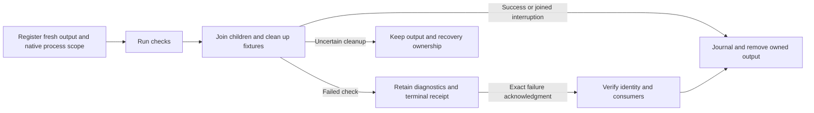

# Restartable cleanup for installed checks

Status: Implementing
Issue: [#322](https://github.com/coletaylor788/puddles/issues/322)
Last updated: 2026-10-19

## Human section

### Design

Failed installed checks retain generated output for diagnosis. Their cleanup ownership currently exists only in memory, so the release manager cannot retire an acknowledged failure after that process exits. Record fresh output ownership and joined cleanup durably, then expose explicit retirement through the existing release CLI.

#### Registration and completion

The wrapper registers only an empty directory or empty nested directories. A sibling control directory records its exact identity, owner, run identifier, creator process and dedicated native process scope. Nested native commands inherit that scope without losing their supervising scopes. Existing output cannot be adopted by name or age.

After fixture cleanup, all registered children must be stopped and registration complete. Failed checks retain diagnostics with a terminal receipt. Successful or cleanly interrupted checks use the same guarded removal path. Uncertain joining, failed fixture cleanup, or source and recovery markers in failed output keep the output in a recovery hold.

#### Retirement after restart

A maintained release command accepts the exact receipt, owner and run identifier. Failed output additionally requires acknowledgment. It refuses a live creator, open handles, process references, changed directory identity or contents, linked roots and unresolved recovery. It never kills unrelated processes.

The existing atomic journal helper records a unique retirement destination before rename. Removal can resume after interruption using the original directory identity and process checks. The receipt survives outside the removed directory. A running or recovery-required check is not eligible merely because its creator exited. Artifact hashing keeps its existing closed-link default; check-output hashing explicitly records nested link text without following it.

#### Release separation

This correction does not alter agent communication or the frozen application candidate. The current release can continue using native cleanup of its own superseded output after consumers finish. The release tool has its independent installation gate; the wrapper change also requires application harness checks.

### Status

**Approval:** Production approved. The requester authorized the release manager to fix stalled releases and accumulated output. The manager assigned this separate cleanup correction with regressions and retained review. The scope is newly registered check output and restart retirement, with production, backup, source, active consumers and unresolved recovery preserved.

Implementation and focused regressions are authored in an isolated branch. Fifteen focused regressions pass. Retained independent review is clear. All 11 wrapper integration tests also pass. Full gates and installation remain pending. No installed tool or frozen application has changed.

## Agent section

### State

The public and companion worktrees use `codex/restartable-installed-check-cleanup`, based on freshly fetched main. Only public source changes are currently needed.

### Scope and acceptance criteria

- Record ownership before writing check output.
- Preserve failed diagnostics and uncertain cleanup.
- Retire acknowledged terminal output from a fresh process.
- Preserve inherited ownership and interruption cleanup.
- Refuse stale identities, changed content, live consumers and recovery markers.
- Leave unregistered historical output untouched.

### Architecture and decisions

`packages/release/src/check-output.mjs` uses existing atomic JSON, SQLite operation locking, native process scopes and directory hashing. It records a dedicated output lifecycle beside the disposable root. `packages/e2e/src/application-check-cleanup.mjs` registers that lifecycle and keeps the original failure and signal behavior.

The CLI accepts a local request file rather than inline operational metadata. Terminal receipts remain small. Partial removal follows a journaled rename and exact directory identity. No daemon, broker or artifact-pool recovery behavior is added.

### Implementation

New output lifecycle helper and `check-output-retire` CLI operation are included in the standalone runtime file list. The application wrapper adds its native scope to inherited scopes and restores the environment afterward. Directory hashing accepts an explicit nested-link option only for generated check output; artifact callers retain strict defaults.

### Validation

Authored Node regressions cover fresh-process retirement and failure acknowledgment, active creators and foreign handles, replaced output, recovery and incomplete registration, external symlinks, and interrupted removal. Existing application interruption and timeout regressions must pass. The 15 focused release-helper regressions passed in 7.27 seconds with native process retirement confirmed. This includes host identity, stopped zombie handling and a joined native child. All 11 wrapper integration tests passed in 12.72 seconds, including interruption, timeout, failed joining and serial runs. Native supervision completed in 13.262 seconds; the child scope was retired and peak synthetic output was 577,536 bytes. The nested supervision test intentionally selects five cases, while the parent run executes all 11 without skips. Run the complete independent release suite and required application harness checks before release.

### Rollout and rollback

Keep this branch separate from any frozen application release. Install the tested release tool between tickets under manager admission, then qualify wrapper integration through its normal lifecycle. Rollback restores prior code while preserving new ownership receipts and retained output. Older tooling must not delete unknown records.

### Review log

The retained independent reviewer cleared the complete current source diff with no material findings or architecture deviations. It verified the 15 passing focused tests and recorded wrapper integration and the complete release package suite as remaining validation gates. The same reviewer remains assigned for behavior changes.

### Checklist

- [x] Isolated source and design recorded.
- [x] Implementation and focused regressions authored.
- [x] Focused release and application cleanup checks pass.
- [x] Retained independent review is clear.
- [ ] Complete applicable gates and installation.
- [ ] Source landed and owned development output finalized.
