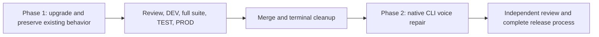
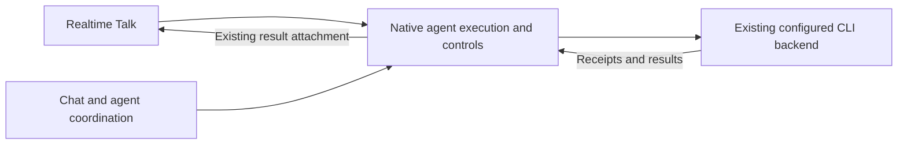

# Latest stable and native CLI voice controls

Status: Production approved in two independent phases; upgrade in progress
Issue: https://github.com/coletaylor788/puddles/issues/359
Last updated: 2026-11-13

## Human section

### Design

Upgrade to **OpenClaw v2026.11.3, the latest stable release**, and safely finish that production release first. Then make and independently release the remaining integration repair between realtime Talk, native agent coordination and the configured CLI runtime. Preserve native CLI authentication, concurrent conversation, same-run steering and proactive research results.

#### Phase 1: upgrade and preserve existing behavior

Qualify the entire maintained application, including integrations, permissions, sessions, memory, tools, provider routing and state migration. Port existing patches only as needed to preserve their behavior. Remove a patch only when the replacement and its regression coverage are proved. The new voice repair is excluded from this candidate.

This phase has its own focused checks, independent review, build, DEV, full application suite, TEST, production acceptance, merge and cleanup. An upstream unit-test pass alone does not qualify the upgrade.

The upgrade provides

- Native Claude CLI text steering into the running process, with current-authority checks and consumption receipts before recording acceptance.
- Existing transcript/cancellation handling and explicit uncertain-delivery outcomes, without blindly replaying accepted input.
- Stable's fixes for keeping private child completions out of streamed replies and allowing replacement work after a cancelled child's handoff.

Stable does not include main's unified session controller or the injected child-result context fix. Those must not be counted as upgrade benefits.

One upgrade behavior needs a separate decision. Stable removes Workshop's staged
skill proposals and uses immediate, versioned skill changes with native undo.
The previous tool already allowed an authorized caller to apply its proposal,
but creation itself stayed pending. The proposed adjustment is to adopt native
Workshop behavior, preserve the existing tool and agent access limits, and use
native Doctor to export pending drafts. It does not recreate a proposal queue.
This adjustment remains proposed; the affected compatibility port is paused.

#### Phase 2: repair native CLI voice coordination

Begin implementation only after Phase 1 has passed production and completed source merge and terminal cleanup. Start from that landed upgraded baseline, with a separate candidate and the full development and release process. The patch will:

1. Route Talk through the agent's configured runtime while retaining its admitted caller, session and asynchronous result ownership.
2. Connect Talk steering, coordinator guidance and child completion to the **same native CLI execution and guarded control capability**. Reconcile embedded-only ownership checks with that actual run. Keep one result claim and native continuation after yield.
3. Preserve each injected input's full context and provenance, so Reader's result reaches a busy parent as a child completion rather than an empty wake-up or new human request.

Reuse native transport, tools, sessions and delivery. Do not retain the first repair's CLI-ready flags or steering refusal, substitute cancellation/restart for steering, or add another message queue. Retire existing patches only after replacement proof.

#### Qualification

**69 existing checks passed on unmodified latest stable in 99.67 seconds.** They cover the real CLI stdio adapter with fixture processes, text injection, authority checks, consumption receipts, cancellation, Talk controls and delayed-result ownership.

The complete repair still must prove one continuous scenario: delegate research, keep talking, steer the same task, let Reader finish while the parent is busy or has yielded, and receive the corrected result proactively. Require actual native CLI execution, exact permissions, no duplicate work and one final delivery through browser and the maintained FaceTime path.

### Status

**Approval:** Production approved for both phases, in order. Phase 1 upgrades and preserves existing behavior. Phase 2 implements the native CLI voice repair only after Phase 1 completes its independent production lifecycle. Approval covers implementation, commits, pushes, review, CI deployment, merge and cleanup within this scope.

**Approval reference:** “One change. Make it have two phases, that follow dev process independently. I.e we upgrade first, safely roll to prod, then we make the patch and safely roll to prod. Upgrade is holistically ensuring existing tests and behavior doesn’t break. Then approved to ship, push, and implement” (2026-11-13).

**Progress:** Phase 1 compatibility qualification is active. The selected public and private ports are source-reviewed and compose in order against exact stable, excluding Workshop. The CLI preparation, native scheduling and single-hook corrections are source-reviewed and compose with all selected overlays. Type qualification is running; affected native checks follow. Runtime qualification is not complete. All 36 focused private contract checks and the 21 manifest/runner checks pass. Workshop proposal retirement remains held for design review. No immutable build or installed CI run has been submitted. Phase 2 implementation has not started.

## Agent section

### State

Selected target: `v2026.11.3`, commit `847611dcaa3bf0e2783335f961dd1fd0580e4d9f`, published 2026-11-10. Release/tag APIs were reconfirmed on 2026-11-13. Earlier runtime source pin: `eb377ac59e6c9fd6c7705028034812becf00271b`.

Main `466a4b6f5073b5fe83b6a0b479a6dfc8392c82e4` is comparison evidence only. The previous proposal's main-based unified-controller and ambient `withSessionTurn` assumptions do not describe stable and are superseded here.

The initial stable qualification ran on an unmodified checkout with Node 26.1.0 and pnpm 12.15.0. The isolated checkout now holds ordered compatibility ports of the existing patch stack. Tests use isolated fixture state, without external messages or production changes.

### Scope and acceptance criteria

Phase 2 maintained patch: **`native-cli-voice-coordination.patch`**. Its three reviewed contracts are configured execution/ownership, shared guarded control/completion, and injected input context. No full session-controller backport, new harness, custom delivery watcher, replay queue or API-auth replacement is in scope.

Cover ordinary chat, direct CLI agent/child turns, provider-owned Talk and parent continuation. Preserve exact physical session, run, source and authority identity, plus existing non-CLI behavior. The maintained Puddles patch bundle and runtime/state upgrade still need qualification against the new version.

### Architecture and decisions

| Contract | Stable evidence | Required integration |
|---|---|---|
| Native CLI steering | Anthropic `registerMessageInjection` and host `createSteeredCliMessageInjection` provide guarded V2 with consumption receipts. `attachCliReplyBackend` requires a reply operation. | Reuse that capability and authority checks. |
| Runtime/owner selection | Talk calls embedded execution. Direct command ingress prepares its own admission and does not automatically create a `ReplyOperation`. Stable lacks main's CLI turn-admission wrapper. | Share ordinary configured execution under the correct native owner, preserving Talk admission. A command-entry substitution alone is insufficient. |
| Cross-caller controls | Talk, `sessions_send` and busy-parent announce select the embedded-run registry; its CLI diagnostic handle lacks V2. Native reply-target injection already supports CLI V2 and captured backend identity. | Connect these callers to the genuine capability with exact owner binding. Preserve mismatch refusal and accepted-unconfirmed custody. |
| Talk ownership | Provider-owned Talk requires embedded completion registration/authority before steering and consumes a one-time claim before append. | Reconcile existing checks with the real execution owner; preserve requester-final transfer after yield. No readiness boolean or first-output authority. |
| Child-result context | Stable injection takes text/currentness callback but no per-input context/provenance; injected prompt hooks suppress private initial context. | Port the relevant per-input contract from upstream #185945. Do not inherit the running input's context or mislabel the child as human. |

Two native bridge locations remain to compare in implementation qualification: use the existing captured ReplyOperation target, or expose the same genuine CLI V2 capability through the existing native active-run handle. Both must retain real authority, exact admitted instance and cleanup ownership. Do not create a second sink or competing owner.

Stable reply-turn kinds (`visible`, `heartbeat`, `queued_followup`) affect scheduling, stale recovery and continuation. Do not select one mechanically just to obtain a registry entry. A broader lifecycle/state redesign requires revised review. This bounded ownership mapping remains unproven; source inspection alone cannot establish the smallest sound bridge.

Relevant upstream evidence:

- [Stable release](https://github.com/openclaw/openclaw/releases/tag/v2026.11.3) and [release notes](https://github.com/openclaw/openclaw/blob/847611dcaa3bf0e2783335f961dd1fd0580e4d9f/CHANGELOG/2026.11.3.md): private completion streaming #188490 and cancelled-child handoff #178893 are shipped. Their specific regressions were not separately run in this focused qualification.
- [Native CLI steering #159816](https://github.com/openclaw/openclaw/pull/159816): represented in stable source and release history; local fixture-level checks below passed on the selected tag.
- [Input context #185945](https://github.com/openclaw/openclaw/pull/185945): relevant main repair absent from stable. Port its narrow context/provenance contract, not the entire main runtime.
- [Coordinator steering #178865](https://github.com/openclaw/openclaw/pull/178865): main uses operation authority when CLI placeholder authority is absent. Design evidence, not a shipped stable capability claim.
- [Talk routing #164229](https://github.com/openclaw/openclaw/pull/164229) and [phone routing #191683](https://github.com/openclaw/openclaw/pull/191683): useful routing, terminal and permission cases. Neither proves this full scope. Do not adopt cancel-and-replace as in-place steering or guest phone ingress as owner authority.
- [Owner steering #189418](https://github.com/openclaw/openclaw/pull/189418): check projection under the selected stable admission. Do not automatically add a main-specific patch or relax permissions.

### Implementation

#### Phase 1

Workshop compatibility is blocked on a design decision. Old `create`/`update`
stage a draft, with a separate native `apply` action. Stable
`src/agents/tools/skill-workshop-tool.ts` calls native library mutations directly;
`legacy-config-migrations.runtime.skills.ts` removes `approvalPolicy` and
`maxPending`. Existing pending-draft export and migration need fixture proof.
Do not mechanically remove the new sandbox gate or restore a custom proposal
subsystem. Proposed native adoption must be approved before this affected port
or configuration migration changes the deployed contract.

Upgrade compatibility includes the integrity-bound pnpm 12.15.0 toolchain and native schema migration from shared state 18 / agent 23 to shared state 22 / agent 27. The existing-state regression seeds the exact predecessor schemas with synthetic sessions, committed WAL history, memory, disabled cron and execution denial settings. It runs the candidate's native migration and verifies reopened data; fresh state does not substitute for this proof.

1. Fetch both feature repositories and rebase preserved work before submission. Pin stable and review every maintained public and private patch. Port only existing behavior; retire only proved redundant hunks with durable replacement coverage.
2. Update the package graph, build tooling, test registration and runtime configuration compatibility as required by the stable upgrade. Preserve current provider routing and security boundaries.
3. Run focused compatibility checks and retain independent review of the complete upgrade diff. Build one reusable candidate and submit it through `ci-dev`, then `ci-prod` with its full application suite and installed acceptance.
4. Require the terminal production receipt, exact source merge and all source/transfer/cleanup closure before starting Phase 2. Record physical acceptance separately from automated readiness.

The stable Talk implementation replaces `talk-agent-parity.patch`. Remove its
runtime hunks and retain the two offer-close lifetime cases under the existing
Talk overlap regression patch. Native tool permissions, detached admission,
source revocation and result ownership remain the runtime owners. Existing
configuration that selects ordinary approvals must migrate only its obsolete
setting, with exact before/after validation.

#### Phase 2

1. Start a fresh feature branch from the landed Phase 1 baseline. Reconfirm the three approved contracts against that exact runtime.
2. Resolve and test the native ownership bridge, then implement the three scoped contracts. Use native registry/admission operations with one execution and delivery owner.
3. Exercise real provider-owned `runPrompt.steer` and adopted `claimAppend`. Do not bypass wrapper checks or let fixtures grant completion unconditionally.
4. Check actual allowed tools and denied execution, including caller caps, logical provider rules, source revocation and CLI-native controls. Retain the independent reviewer through remediation.
5. Independently build, qualify DEV, run the full release gate, qualify TEST and PROD, merge and close cleanup. Phase 1 evidence is baseline evidence, not release clearance for changed inputs.

### Validation

Phase 1 local compatibility: all eight public plugins compile against the pinned `openclaw@2026.11.3` SDK. Their existing suites pass 364 tests with no skips. The public lockfile was regenerated and installed using pnpm 12.15.0 and the shared store. The first dependency-order check required building `mcp-hooks`; compilation then passed. These checks do not replace the complete application or installed candidate gates.

Focused compatibility ports now have additional evidence. The iMessage coalescer passes 41 cases, independently rerun by the retained reviewer. The browser entrypoint fixture passes against the ported source. The corrected native delegation suite passes 43 cases in 35.05 seconds. Heartbeat prompt and terminal resolution pass 65 cases in 16.05 seconds; the two Copilot inbound-context cases pass in 27.28 seconds. These focused source checks do not prove the final composed runtime, prompt generation, installed startup, or production readiness.

The retained reviewer cleared the wiki metadata port and verified correction of delegation fixtures that still used the retired roster shape and test configuration owner. State-migration SDK qualification now passes all six Doctor cases. The preview preserves legacy owner provenance and uses native authentication ownership preparation, matching the writer without weakening exact equality. Explicit owners, workspace, fixed-store and included-file refusal cases pass. Installed schema migration still requires the composed build.

Current composed-source qualification preserves the native maintenance boundary: all 12 idle cases pass, including foreground preemption, and the 23 bridge cases pass. The memory tool tests retain exact permission intersections. Corrected FaceTime readiness passes 11 cases, native storage custody 13, direct provider selection 8, and Gateway plugin behavior 69. The other existing FaceTime groups passed their first run. Storage cases use the same forked-process inventory as native browser tests. Native Claude runtime passes 54 cases, including failure with the original snapshot-retention error before any compaction acknowledgement. Core and extension runtime typechecks pass; complete test typechecking remains open. Required public PR checks pass at `ac7d5fab`; subsequent source changes still need their own checks. No immutable build or CI deployment has been submitted.

Active Memory fixture cleanup passes all 109 native cases in 79.20 seconds. The managed child-process bundle check passes after relocation into native tooling tests (one case, 2.83 seconds). Patch-manifest checks pass all nine cases in 0.25 seconds. The recovery run completed with 164 passing cases and four failures in 348.15 seconds: one displaced-input refusal expectation, two startup waits caused by an invalid registration fixture, and one retry using the same invalid fixture. The prepared-source digest stayed unchanged through that run. Native type-boundary checks also require moving provider-specific race tests out of the core test graph. The corrected core gateway suite passes 23 cases, the harness suite passes 43, and the corrected provider delegation suite passes 28. Both provider/Gateway race cases pass in 12.05 seconds after the fixture corrections. Restored progress and Copilot-to-Talk integration tests pass all ten cases in 12.70 seconds. The full iMessage port is now reconciled from the exact stable prefix. Its native scheduler and debounce fixtures preserve the original assertions; all 110 targeted cases pass, including the 46 monitor cases in 24.93 seconds. The earlier omission and fixture failures are closed. The full prefix applies through the reviewed memory and profile ports; remaining Code Mode/MCP review and private composition still block the complete candidate.

Completed on unmodified `847611dcaa3bf0e2783335f961dd1fd0580e4d9f`:

| Existing test file | Result | Duration |
|---|---|---|
| `src/talk/agent-run-control.test.ts` | 15 passed | 29.94 s |
| `src/gateway/test/talk-client-agent-consult.requester-final.test.ts` | 2 passed | 14.27 s |
| `src/agents/cli-runner/execute-plugin.steering.test.ts` | 1 passed, covering configured/session/explicit input routes | 18.31 s |
| `extensions/anthropic/cli-runtime.test.ts` | 51 passed | 28.71 s |

Command: `pnpm test` with those four explicit files and `--maxWorkers=1`. Exit 0; four shards passed in 99.67 seconds. Fixture processes exercise the real stdio adapter, not authenticated Claude. Talk delayed-result tests use an embedded fixture. Neither proves the repaired composed path. No full application build, cumulative suite, installed DEV/TEST or physical audio check was performed.

Phase 1 acceptance requires every existing application suite and maintained public/private patch regression, compatible plugin packaging and startup, preserved sessions/state, tool access and denials, provider authentication/routing, messaging, memory, browser, calendar and maintained voice paths. Any removed regression needs evidence that its behavior is covered by the new runtime and cumulative runner. Existing voice limitations may remain; regressions may not be hidden by the pending repair.

Phase 2 candidate proofs:

- Chat, voice and coordinator corrections reach the intended active CLI run/process; unavailable or incompatible input is not lost or replayed after acceptance.
- Reader's opaque result and provenance reach a busy or resumed parent without history polling; the final reaches Talk proactively once.
- Actual Talk readiness, authority, claim and continuation attachment survive startup, fallback, cancellation, stale-source and hangup races.
- Installed native CLI login, warm continuity, allowed synthetic operations and denied/revoked operations pass without exporting credentials or delivering real test messages.
- Browser and maintained FaceTime qualify against the same candidate, with physical audible delivery separately confirmed.
- Full maintained-patch compatibility, application suite and runtime/state migration pass through CI before production.

### Rollout and rollback

Each phase independently uses the normal development process and immutable candidate. Phase 2 cannot enter implementation before Phase 1 terminal production, merge and cleanup closure. Upgrade latest stable, not moving main. Preserve the working CLI baseline. Use `build`, `ci-dev`, and `ci-prod`; CI owns installed tests, full suite, deployment, merge, recovery and cleanup. Yield after dispatch and resume from terminal receipts. Recovery uses the captured current baseline, never the superseded pre-CLI harness. Preserve active candidates and recovery references until closure.

### Review log

The retained reviewer independently checked the full stable checkout. It confirmed native CLI V2 exists but direct command/Talk execution does not automatically own a ReplyOperation; Talk, coordinator and announce callers still select the embedded registry. The proposal separates three remaining contracts and removes the assumption that main's unified controller ships in stable. Architecture review and component tests do not constitute full repair or release clearance.

### Checklist

- [x] Pin and inspect latest stable separately from main.
- [x] Run focused unmodified native CLI, Talk-control and delayed-result tests.
- [x] Separate shipped fixes from the proposed patch's three contracts.
- [x] Record approval for two independently gated production phases.
- [ ] Phase 1: preserve all existing behavior and complete independent upgrade review and qualification.
- [ ] Phase 1: close production, source merge and cleanup before Phase 2 starts.
- [ ] Phase 2: resolve the ownership bridge and qualify the complete voice/CLI/Reader scenario.
- [ ] Phase 2: complete its own CI-owned release, cleanup and physical acceptance.

#### Composed upgrade qualification checkpoint

The first frozen composed run completed 2,132 passing tests, 35 failures and one Linux-only procfs test skipped on macOS; one additional suite failed during collection. Eight requested agent-core files were not reached after an earlier native project failed. The source digest stayed unchanged through the run. This is diagnostic evidence, not release clearance. Native realtime provider coverage passed 141 cases and native Claude CLI provider coverage passed 119 cases.

Corrections preserve existing behavior: additive control names and direct/catalog visibility, selected skill access, exact grant facts, recorded-owner cleanup, current pooled-client deletion and native SQLite test ownership. Retired provider task API fixtures use supported teardown failure boundaries. The reviewed private runtime corrections also address six type errors. Affected native reruns and typechecks are active; full application and installed CI gates remain required.

The next composed correction run passed 334 cases and left three fixture failures: one synthetic CLI backend cleanup case and two Copilot compaction owner checks. Prepared source stayed unchanged throughout. The synthetic preparation hook enters native authentication selection; explicit environment-only authentication reaches the hook, but the expected MCP resource is still not acquired. That remaining fixture failure needs runtime diagnosis. Native compaction callbacks intentionally omit host-only memory policy, so the owner checks must observe the real host hook while retaining callback timing and verifying no policy leak. The eight previously unreached agent-core files separately passed all 197 cases in 43.14 seconds. Current pushed public and companion repository checks pass. These are local compatibility results, not release clearance.

All four native root test-type groups pass (tooling 50.9 seconds, scripts 61.9, end-to-end types 53.9, other root tests 82.5). The 19 maintained patch-manifest and application-suite contract tests also pass. Test project bindings now use the native collector's exact Gateway subprojects; the tool-search run-plan regression uses its native unit-fast project.

The corrected Copilot attempt suite passes all 117 cases in 36.37 seconds, including source-owner preservation at the host boundary and private-policy exclusion from plugin callbacks. The CLI backend cleanup fixture still fails and remains an open qualification item. No assertion was weakened to pass it.

Native discovery finds all 270 maintained test/project pairs across 33 projects. Stable's Gateway server project now contains native child projects. The application runner preserves that configuration and passes only selected regression paths rather than embedding the container inside a combined project. Its 21 focused contracts pass, and a real native discovery-only check confirms both the ordinary combined path and the intact Gateway container. This does not claim another runtime test pass. Extension test typechecking found fixture typing errors; corrections remain under retained review. A bounded CLI diagnostic reaches every MCP materialization gate, so the namespace spy's zero count is insufficient evidence of skipped acquisition. The temporary diagnostics were removed and the original source digest restored.

All 46 selected patches now compose to the reviewed stable source, excluding the held Workshop port. The prepared source matches that composition. The retained reviewer cleared the final Code Mode permission corrections and their exact dependent rebases. The new host-skill and prompt-policy regressions are registered in their native projects. A 51-file affected native pass and serial runtime/extension/core test-type checks are running on the unchanged composition. The remaining MCP cleanup fixture failure was measured as a one-second polling deadline race: materialization and cleanup entry both occurred, and settlement waited for gate release. The reviewed fixture uses a bounded ten-second setup wait while retaining every acquisition, failure and cleanup assertion. Actual native execution through both ordinary combined and Gateway container paths passed.

The refreshed runtime checks both fail on an undefined `claudeSkillsPlugin` reference in moved CLI skill setup. The first eight native files passed, but the following preparation cases hit the same error. The affected native and type runs were interrupted, their descendants were confirmed exited, and the prepared source digest remained unchanged. Do not treat the interrupted test-type checks or unrun groups as passing. Repair this integration before rebuilding qualification evidence.

The independent surface pass completed on the unchanged composed source with 152 passing and 13 failing cases. It found an adapter queue blocking native Code Mode controls behind the sequential tool they coordinate. The proposed correction reuses native scheduling identity and keeps captured execution context; ordinary tools retain their existing queue. Other failures concern selected-skill availability, native hook preparation counts and fixtures relying on older tool or configuration defaults. These failures remain open until corrected source passes native checks. No build or CI dispatch occurred.

The reviewed correction composition is `76a881d955dda8eccac29f69800cb8a470bf3c78`. All 46 selected patches apply strictly, with Workshop still held. The exact prepared source was reconciled in 12 reviewed paths. Corrections preserve one native hook owner with the Gateway caller context, selected skill access through current grants, native direct/scripted scheduling and ordinary tool ordering. Serial fail-fast runtime and test-type qualification is running, followed by the affected native cases. Repository checks passed for the preceding public/private heads; refreshed heads need their own results.
