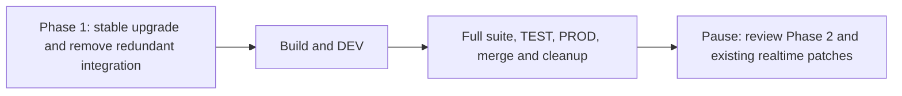
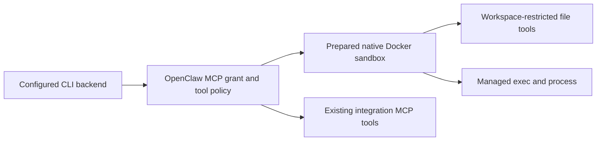
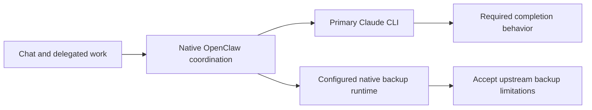

# Stable upgrade and native CLI voice controls

Status: Phase 1 production approved with one sandbox handoff patch; pause before Phase 2
Issue: https://github.com/coletaylor788/puddles/issues/359
Last updated: 2026-11-16

## Human section

### Design

Upgrade to **OpenClaw v2026.11.4**, use native CLI execution and remove redundant
integration patches. Preserve current integrations, sessions, permissions and
sandboxing. Finish that production release, then pause for review of realtime delegation,
steering and all existing realtime patches.

The selected target is v2026.11.4, published on November 16. Qualification of
v2026.11.3 exposed a native MCP bug: plugin hooks lost the owner's identity.
The newer stable release fixes that path natively in
[PR #190138](https://github.com/openclaw/openclaw/pull/190138). Use that release
within the approved latest-stable upgrade, preserving its CLI startup and OAuth
lock fixes too. Re-audit retained patches and repeat affected qualification.
This adds no custom identity patch and does not start Phase 2.

#### Phase 1: use native behavior

The registered CLI backend runs the selected local CLI using its native login.
Model configuration selects the runtime. This route is distinct from ACP and
does not require replacing native subscription authentication with API billing.
Include the approved native CLI update in the immutable application artifact;
each environment uses its own copy. Preserve the user's normal launcher and
existing sign-in profile.

| Capability | Native behavior to adopt |
| --- | --- |
| Model execution | Registered backend, model runtime selection, native authentication and session binding. |
| Tools and configured MCP | Policy-filtered OpenClaw catalog, exact run grants, server instructions and native cleanup. |
| Managed Claude file and shell tools | OpenClaw file controls and execution tools through MCP; native file/Bash tools are disabled on ordinary managed turns. |
| Steering and cancellation | CLI text injection with current-authority checks, consumption receipts and native cancellation. |
| Long shell commands | Managed exec/process handles and originating-conversation completion notifications. |
| Compaction | CLI-owned compaction and supported native manual control. Additional memory snapshot behavior remains separate. |
| Workshop | Immediate skill saves, version history, undo and native pending-draft export, preserving existing access limits. |

Stable also contains fixes for private child-completion streaming and replacement
work after a cancelled child's handoff. It does not contain newer main's unified
session controller or injected child-result context fix. Do not count those as
stable benefits or claim the complete realtime scenario is already repaired.

#### Sandbox handoff repair

Keep the ordinary OpenClaw Docker sandbox and managed exec/process tools. The
CLI stays on the Gateway, where it calls OpenClaw tools through the existing
MCP grant. One approved source patch supplies those tools with the prepared
session sandbox. No additional node service, custom message routing or native
Bash bypass is introduced.

Adapt upstream [PR #163238](https://github.com/openclaw/openclaw/pull/163238)
to the pinned stable APIs. Prepare the sandbox only when the effective coding
tool surface needs it. Keep its lifetime with the native run/grant owner, bind
both files and shell to it, and fail closed on preparation failure. Preserve
workspace restrictions, read-only modes and authority revocation at the final
operation. Existing background command handles and completion notifications
remain native OpenClaw behavior.

Review every upstream comment and inline finding. Incorporate relevant fixes;
record evidence for findings that do not apply. Preserve existing backend removal
semantics, including literal tilde paths and recursive limits. Do not copy older
PR code over newer stable ownership/disposal APIs. Unsupported third-party
bridges must not silently acquire mutation authority. Tests must cover the full
CLI/Gateway path as well as backend units, failure and cleanup.

The previously tested Docker-node route is feasibility evidence only and is not
the selected design. Existing native CLI child/cron admission restrictions stay
intact; this patch does not bypass them or expand runtime placement authority.

#### Native history and permission compatibility

Stable can launch Claude with a dedicated `CLAUDE_CONFIG_DIR`, but some history
readers still assume the default directory. Upstream merged
[PR #175549](https://github.com/openclaw/openclaw/pull/175549) fixes that recovery
path. The harness/history follow-up category will evaluate this native replacement
after both phases, with cold resume, history and compaction proofs. Bind the existing login root in
the Gateway environment. The upstream fix uses it only without an explicit
offline `homeDir`; check Doctor, TUI and cold/history callers before retiring
profile plumbing. It is not part of v2026.11.4. Keep credentials in their existing
native profile.

Workspace-only policy is a hard boundary. It does not reproduce our old
allow-once outside-file approval sequence. Prefer native confinement and explicit
resources over rebuilding that mechanism just to satisfy an implementation-shaped
test. The approved native boundary applies to diagnostic tools too: shell execution
uses the ordinary Docker sandbox and file tools stay inside their workspace.
Existing MCP role permissions remain. Arbitrary host diagnostics and outside-file
approval are retired; protected paths outside the workspace remain inaccessible.

#### Phase 1 patch retirement

The requester approved removing seven public test-only overlays:
`native-parent-continuation`, `sandbox-discovery-failure-fix`,
`builtin-memory-migration`, `silent-reply-completion-evidence`,
`active-memory-cold-recall`, `active-memory-fixture-cleanup`, and
`gateway-protocol-declaration-portability`.

Also remove `imessage-group-inbound-policy` (unselected behavior) and
`scoped-container-temp-root` (used only by test helpers). Native regressions stay
selected independently of patch records. Tests use native secure temporary
staging. These removals introduce no replacement overlays. The separately approved
sandbox handoff is the only new runtime patch.

`talk-agent-parity` and obsolete Workshop proposal compatibility were already
retired in this candidate; do not count them again. Other audit reductions are
reserved for independent work after both phases, unless separately required and
approved for the realtime repair. Preserve their existing behavior meanwhile.

#### Deferred behavior categories

- Deployment and process lifecycle.
- Talk, realtime and FaceTime.
- Memory and compaction.
- Messaging and delegation.
- Tools, MCP and sandbox policy.
- Harness sessions, credentials and request ownership.
- Model configuration, skills and accounting.

A category is assigned only when the requester asks. Each gets its own design,
qualification and development lifecycle. A broad patch may span categories;
coordinate its consumed hunks before changing it. “Reduce” or “unproven” in the
audit does not mean unconditional removal in Phase 1.

#### CI and upgrade acceptance

Adapt CI to the new native lifecycle. DEV and TEST use normal isolated Gateway
startup and recording fixtures. Held PROD uses native startup canary behavior.
Installed plugin metadata does not establish runtime loading or authentication;
the same artifact must pass full authenticated TEST acceptance first.

Qualify the complete application: integrations, subscription login, exact tool
policy, files and shell, unavailable-sandbox refusal, session/cold continuation,
steering and cancellation, memory, compaction, migrations and cleanup. Include
ordinary and restricted turns, existing delegated admission/refusal, and
supported completion paths. Test observable behavior rather than a required
Claude-native tool name. Keep unresolved permissions as failing
acceptance gates until the reviewed behavior has a durable regression.

Preserve and rebase both source branches on current main. Use installed `build`,
`ci-dev` and `ci-prod`, with retained independent review and required checks.
Yield after dispatch; CI owns deployment, full tests, TEST, backup, PROD, merge,
recovery and cleanup. A passed workflow is not a terminal deployment receipt.
Recovery keeps the current CLI baseline and never overwrites new live writes
or restores an older runtime over migrated state.

#### Additional completion repairs (withdrawn)

The requester rejected both proposed runtime repairs on 2026-11-16 and directed
us to leave plugin lifetime, delivery, steering and completion handling with
native OpenClaw. Neither repair was implemented. Do not add our own plugin-context
detachment or extend the prompt helper to inject completion reports.

Qualification still shows two failures: a delayed reply or maintenance callback
can inherit a closed plugin invocation, and the plugin harness can receive a
completion wake-up without the child report in its model input. These findings
are release blockers, not justification for additional runtime patches.

Audit the retained public and private patches against exact stock upstream
behavior. Identify whether removing our interference restores native operation.
Then qualify supported configuration or an upstream stable fix through the
existing lifecycle. A clean application of our patches does not prove they are
needed, and a stock throwing function does not prove the surrounding customized
path is uninvolved. Do not bypass these failures or change tests to accept lost
results. Production remains unchanged while this investigation continues.

Upstream [PR #199618](https://github.com/openclaw/openclaw/pull/199618) and
[PR #198487](https://github.com/openclaw/openclaw/pull/198487) remain investigation
references. Their existence does not authorize a custom backport. The approved
sandbox handoff remains separate. Phase 2 and the broader realtime patch review
stay deferred.

Acceptance remains native asynchronous completion with one visible result,
working steering, unchanged transcript/provenance, untrusted result handling,
current policy and stopped-plugin denial, and cancellation when session or
source ownership changes. The full application and installed gates still apply.

#### Stock backup behavior (approved)

On 2026-11-16 the requester said: "Keep copilot cli stock and accept any
degradation because it’s the backup path." Claude CLI remains the primary
runtime. This authorizes retiring backup-only custom behavior and its parity
requirements. It does not authorize either withdrawn completion repair.

Keep the configured native plugin-to-SDK-to-CLI backup route. Do not silently
switch to the built-in provider loop or create another adapter. Remove
backup-specific prompt, usage, latency, memory-journal and yield overlays, plus
backup extension hunks in mixed public patches. Split mixed cleanup and model
patches by consumer before removing them. Preserve shared credential ownership,
requester authorization, sandbox confinement, external-write approvals and
recovery-safe deployment locks. No new runtime behavior is added to compensate
for upstream backup limitations.

| Qualification | Primary Claude CLI | Stock backup |
| --- | --- | --- |
| Direct tool result and untrusted input handling | Required | Required for supported tools |
| Delayed result, spawn completion and yield | Required | Native limitations accepted; no custom parity repair |
| Ordinary turn, resume and configured fallback/restore | Required | Required |
| Shared text/voice transcript storage | Required | Preserved; custom injection into the backup prompt is retired |
| Workspace/shell confinement and external-write approval | Required | Required or capability unavailable; never bypassed |
| Realtime steering and proactive completion | Phase 2 qualification | Degraded native behavior accepted |

Retire assertions tied only to removed backup enhancements. Keep primary
assertions and all safety checks. Record known limitations explicitly rather
than report an unexercised or degraded path as equivalent. Rebuild and qualify
the reduced composition through the normal DEV and PROD process. Phase 1 still
ends with production acceptance, exact merge and eligible CI cleanup, then a
pause before Phase 2. Passing chat tests does not establish realtime acceptance.

#### Phase 2: realtime coordination

After Phase 1 production, merge and cleanup close, pause for requester review
of the proposed repair together with all existing realtime patches. Do not
implement Phase 2 until that discussion produces renewed approval. The prior
proposal is retained below for discussion:

1. Route Talk through the agent's configured runtime while retaining its caller,
   session and asynchronous result ownership.
2. Connect Talk steering, coordinator guidance and child completion to the same
   native CLI execution and guarded controls. Keep one result claim and native
   continuation after yield.
3. Preserve each injected input's context and provenance so a child result is
   consumed as a completion, including while the parent is busy.

Use native sessions, controls and delivery. Do not retain the first repair's
CLI-ready switches or steering refusal, add a second message queue, or replace
steering with cancellation/restart.

Prove one continuous scenario: delegate research, keep talking, steer the same
task, and receive the corrected result proactively after completion, whether
the parent is busy or yielded. Require real native CLI execution, permissions,
no duplicate work and one result through browser and FaceTime. Repeat the full
build, DEV, TEST, PROD, merge and cleanup lifecycle independently.

#### Supporting Node interpreter update

Use Node 26.13.1 for CI, builds and the upgraded Gateway. Node 26.1 has a SQLite
column-metadata bug after schema changes; the unchanged database recovery test
exposes it. Node's [upstream fix](https://github.com/nodejs/node/pull/64219) is
included from 26.6.0 onward. A minimal reproduction and the unchanged recovery
test pass with the checksum-verified 26.13.1 binary.

Stage the new interpreter alongside the old one. Adopt it for CI only while
both hosts are idle, with consistent workflow and service bindings. The Gateway
switch belongs to the normal stopped deployment and backup lifecycle. Preserve
both normal and held service definitions in the backup and verify their exact
interpreter after deployment. Keep unrelated explicit tool launchers unchanged.
The new interpreter requires a fresh candidate, DEV and full production gate.

#### Retained patch test compatibility

The retained `untrusted-agent-results.patch` adds a configuration read to the
reply flow. Three native delegation tests do not supply that configuration. The
patched flow rejects immediately, while the test waits for a callback that never
occurs. Native test isolation reproduces the failure. This is compatibility with
our retained patch, not an independent upstream test defect.

Make one test-only adaptation in that retained patch: pass
`config: context.getRuntimeConfig()`
to this fixture's `runSessionsSendA2AFlow` call. The retained patch already adds this
parameter. The same Gateway test context then supplies its configuration, while
all disconnect, revocation and reply assertions remain intact. No runtime code,
timeout or selected test changes. Do not restore the retired preload patch.
This is a compatibility correction within the already approved retained patch.
It preserves that patch's purpose and behavior. The earlier request for another
approval applied the patch policy too broadly and is withdrawn. No new patch or
runtime behavior is authorized by this clarification.

The provider health-check fixture also needs to drain its incoming HTTP request
before it can reliably observe client closure on Node 26.13.1. Add `socket.resume()`
to the existing raw test server within the retained lifecycle patch. Keep the
response unfinished, cancellation requirement, assertions and one-second bound.
The negative control without cancellation must remain open. This test correction
changes no runtime code or service behavior.

### Status

**Approval:** Production approved for Phase 1, including the stable and CLI
upgrade, the 12 approved removals, and one sandbox handoff patch adapted from
upstream PR #163238. All other patch categories remain deferred.
**Approval reference:** On 2026-11-15 the requester approved the proposal plus
this one patch, required every upstream review finding to be incorporated or
dismissed with evidence, and instructed: "Implement, push, and ship."
**Stop condition:** The requester then instructed us to pause after Phase 1
successfully lands in production. Complete production validation, exact merge
and CI cleanup, then stop. Phase 2 requires further discussion of all realtime
patches and is not authorized to start automatically.

**Additional repair decision:** Rejected by the requester on 2026-11-16. Neither
repair was implemented. The requester subsequently approved stock backup
behavior with accepted degradation. Retire backup-only overlays and parity
requirements while preserving primary Claude and all shared access controls.

**Progress:** The plugin inventory repair is reviewed and passes its installed
regression. DEV then passed real Claude subscription qualification but failed
cleanup because Docker Desktop woke its shared VM after the test gateway started.
The cleanup check incorrectly required the VM to be older than every gateway.
CI completed teardown naturally and source cleanup is closed. The reviewed repair
recognizes the shared VM through its exact identity, backing files and container
mount checks, without depending on start order. It retains all real-consumer
refusals and never stops Docker or production. Fresh build and DEV are required.
Phase 2 stays paused until Phase 1 acceptance, exact merge and cleanup.

## Agent section

### Sources and findings

#### Current fixture cleanup correction

Docker Desktop can wake its shared VM after the test gateway starts. The fixture
cleanup check must recognize that service through its exact process identity,
backing files and container mounts, without assuming it started first. It still
rejects real fixture consumers, unknown processes and running or stopped containers
that mount the fixture. The shared VM is never stopped. Eleven focused cleanup
tests and retained review cover the correction; fresh installed DEV remains required.

#### Plugin inventory qualification

Native plugin discovery can report an informational notice when an explicitly
configured package wins over a retained older installation. CI must verify that
unique winner against the frozen configured path, rather than reject the notice.
Warnings, errors, unknown codes, dependency failures and unexpected winners still
fail. A synthetic installed fixture covers both fresh discovery and a reopened
native registry, with no plugin imports or application-data changes. This changes
qualification only. Native plugin selection and production configuration remain
unchanged.

#### FaceTime packaging repair

The prior candidate passed the complete source and installed suites and TEST,
then failed native Doctor after the production copy. Source-only FaceTime files
loaded in a checkout but not beneath npm's `node_modules` directory. Compile with
the target upstream package builder and use its generated runtime manifest.
Explicit native plugin selection preserves bundled provenance while selecting
package-local compiled entrypoints and Doctor contracts. Keep the helper,
resources, frozen dependencies, owner configuration and realtime mode unchanged.

The synthetic registered-service fixture now mirrors the npm path, enables only
FaceTime and rejects its load warnings. It must retain one enabled registry entry
whose source is compiled JavaScript and whose Doctor contract hash matches the
compiled file. Keep its database, skill-draft, service and runtime-preservation
checks. This proves package loading, not physical calling or Phase 2 acceptance.

#### Previous qualification repair

The previous full application suite and TEST passed. Its production preparation
caught an exact service-launcher fingerprint changed by a reviewed CI activation.
The refreshed fingerprint and read-only early DEV/TEST checks passed DEV.

The next source qualification passed its source lane but failed one installed
plugin test. Preserved fixture diagnostics identify packaged Gmail tool discovery.
The old test sent initialization and discovery together and closed stdin without
waiting. The packaged MCP server cancels in-flight handlers on transport closure.
Use its shipped client session to await initialization and tool discovery before
closing. Keep the existing no-network/no-subprocess guard and bounded execution.
Normal local repetitions of the old test passed, so the intermittent scheduling
condition was not reproduced. A delayed synthetic peer now verifies the required
handshake and open channel, alongside real packaged discovery and error handling.
The old fixture fails against that same delayed peer; the repaired fixture passes.

The installed runner saves each group's full output in its owned directory and
retains the group name and a bounded tail in the final aggregate. Sequential
execution, failure joining and all test groups remain unchanged. Six diagnostics
and inventory checks, three discovery cases and all six configured-plugin checks
pass. The latter completed in 46.6 seconds. No runtime patch changes.

#### Stock backup qualification follow-up

Candidate `dfd6580ef31f42bdd54483020232ec05401baaf706da5b7c9959e316130256ae`
passed DEV run `gh-44004160443-1`, with `phase=complete`, no child process,
and source queue/transfer cleanup closed. Production workflow `gh-44006779515-1`
failed in the source application suite after 27 minutes, before transfer or a
target transaction. The failing candidate group had 13 passing files and one
failure in `shared-harness-context.mjs`.

That scenario used a recording SDK with the compiled stock backup harness and
still expected shared transcript text in its system prompt. This belonged to the
retired backup hunk of `shared-conversation-context.patch`. The retained scenario
checks one SDK session creation followed by two resumes, three exact current
requests without replay, native journal validation, and ordered shared transcript
records with voice provenance and no duplicates. The separate installed routing
and shared history test stays required. Neither test establishes Claude realtime
steering or proactive completion. No runtime patch changes for this correction.

Candidate `16e49be9e152f1d0b7c7dd565c01844ec8cf644c33ee4e9dce5741c20fdb265d`
then passed DEV `gh-44011943789-1` with closed teardown and source cleanup.
Production run `gh-44014628278-1` failed before transfer in the existing
`runtime-archive-listing.test.ts` setup: creating 7,500 repeated deep-path tar
members exceeded its 15-second bound. The focused baseline passed in 17.73 seconds
overall, exposing a costly setup rather than an archive acceptance failure.
The fixture now uses Python's existing standard library to read member metadata
and content once and generate the same number of real archive entries. The
default 4 MiB capture rejection, production `installRuntime` listing and extraction,
exact runtime digest, 15-second setup and 30-second command bounds remain.
The corrected focused test passed in 4.48 seconds. No runtime implementation changed.

Candidate `1b5c6f315fda224245323c36eb3cd84969e8895fa8bcb9b8d4fdda3370565985`
passed DEV `gh-44016559134-1`. Production `gh-44018953570-1` failed before transfer
in `heartbeat-native-main-reply`; source queue and transfer cleanup closed. Exact
reproduction showed the backup's next request contained its earlier user message
and current reply, but not the notification from the embedded heartbeat. Native
external delivery queues target awareness instead of appending an assistant message
to the target transcript. Do not invent a canonical transcript assertion for that path.

The companion now explicitly leaves the canonical scenario on the built-in fixture.
Only an undefined provider result chooses that fixture; invalid results and setup
errors fail. A separately named stock backup scenario preserves real delivery,
quiet tails, fresh heartbeat sessions, one resumed main session, current and prior
user input, tool boundaries and continuation. The unchanged native scenario passed
with ten model requests, three sends and two tool calls. This is native heartbeat
and stock backup qualification, not Claude realtime acceptance. The separately owned
native fallback conversion is excluded from this candidate. The complete companion
provider fixture file passed 15/15 tests in 60.43 seconds, including real SDK
transport, ordinary-turn refusal and fail-closed provider selection. Independent
review cleared the final behavior diff. Fresh build and DEV are still required.

Stable target: `d843d6af39a42cd3c30084edbeabeece732fd93a` (v2026.11.4).
Previous qualification used `847611dcaa3bf0e2783335f961dd1fd0580e4d9f` (v2026.11.3).
The official v2026.11.4 release and exact source were checked 2026-11-16. The earlier source pin
was `eb377ac59e6c9fd6c7705028034812becf00271b`. Read the pinned native
`docs/gateway/cli-backends.md`; the website fetch failed in this environment.
Newer main was inspected at `5370661901a61a4aa5c7e9f76174e50eb1ee597b`.

| Source | Use and limitation |
| --- | --- |
| [CLI backend guide](https://docs.openclaw.ai/gateway/cli-backends) | Runtime selection, managed MCP tools, isolation, sessions and compaction. Use the pinned-source copy for stable behavior. |
| [Sandbox PR #163238](https://github.com/openclaw/openclaw/pull/163238) | Open proposal for prepared sandbox capability and grant binding. Inspected head `3033c7d66ef3f2b500abe406e0e4ca4666eb15ff`; not shipped stable. |
| [History PR #175549](https://github.com/openclaw/openclaw/pull/175549) | Merged commit `08d89a8bdf54785bb869994203f43985abc7efa1`; honors config root in transcript recovery. Not shipped stable. |
| [Sandbox hooks PR #191205](https://github.com/openclaw/openclaw/pull/191205) | Embedded attempt hook metadata; distinct from the CLI coding-tool handoff. |
| [Native CLI steering #159816](https://github.com/openclaw/openclaw/pull/159816) | Stable native steering; existing focused transport and receipt tests passed. |
| [Input context #185945](https://github.com/openclaw/openclaw/pull/185945) | Newer-main context/provenance evidence for Phase 2, not an upgrade benefit. |
| [Coordinator steering #178865](https://github.com/openclaw/openclaw/pull/178865) | Main ownership/control evidence; not permission to bypass stable admission. |
| [Talk routing #164229](https://github.com/openclaw/openclaw/pull/164229) and [phone routing #191683](https://github.com/openclaw/openclaw/pull/191683) | Routing and lifetime cases; neither proves the complete approved scenario. |

The sandbox runtime reproduction used composed output. Stock causality was
checked separately: `prepare-tool-policy.ts` is unchanged at the controlling
ordinary mediation logic; `gateway/tool-resolution.ts` resolves sandbox status
without handing `SandboxContext` to `createOpenClawCodingToolsInternalAsync`;
exec rejects the absent sandbox. Native managed tool configuration accepts only
Agent/Workflow, not Bash. Do not describe the reproduction as a clean stock build.

The native delegated child-plan sandbox/CLI tests pass by denying those children.
This is a safe refusal, not successful delegated CLI execution. Do not expand
admission without a reviewed containment and authority contract.

### Patch and configuration implementation

Keep the removal list, patch order, digests and direct native regression targets
synchronized. Preserve the existing profile, configured-MCP and additive scripting
patches while their category work is deferred. Remove demonstrably equivalent
native overlap when porting to the selected stable release, while preserving
the same capabilities. Do not use the port for broader category redesigns or
unqualified history substitutions suggested by the older audit.
Keep credentials in the existing profile and protect retained recovery state.

Workshop uses native edits, version history and Doctor export. Preserve agent
access and the existing sandbox construction bridge. Retire obsolete approval
settings through the declared stopped-state migration. Talk setting retirement
is a separate exact-value migration. Keep recovery captures and bounded Doctor
execution; no manual deletion of recovery data.

### Validation and release sequence

Retain earlier successful evidence only for unchanged inputs. Local composition,
runtime/test types, plugin suites and focused native tests have passed in this
workstream. The last installed integration group passed 9/9; it did not qualify
all subscription-tool behavior. Native workspace confinement passed the real
Gateway fixture in 16.46 seconds. Docker exec was refused for lack of runtime
context. The separate configured-node route passed actual stock Gateway/MCP to
Docker-node execution, workspace file confinement, configured MCP coexistence,
host/node override rejection and disconnected-node refusal. This is isolated
route qualification, not acceptance of the rebuilt upgrade artifact.

1. Implement the approved sandbox handoff patch and all applicable upstream
   review fixes. Preserve native admission; enforce the requested sandbox and
   workspace boundaries using existing configuration.
2. Implement approved reductions and replacements. Keep cumulative tests,
   patch order and digests coherent. Do not patch prepared distribution chunks.
3. Update fixtures for native MCP names and parameter shapes. Use Docker-visible
   paths and test-owned sentinels; verify execution location, read-only access,
   unavailable backend, revocation and absence of host fallback.
4. Requalify login, cold/warm history, policy intersections, compaction,
   continuation, integrations and existing-state migration. Keep external
   mutations and message delivery on explicit recording adapters.
5. Preserve/rebase source on fresh main, complete retained independent review,
   required checks and sealed build. Dispatch DEV and yield. Inspect actual
   terminal deployment and source cleanup before production submission.
6. CI runs full application tests, TEST, backup, PROD, exact source merge and
   cleanup. Stop there for the requested Phase 2 and realtime-patch review.

CI startup adaptation remains application qualification work. Normal DEV/TEST
and held PROD canary must preserve exact artifact/configuration bindings and
read-only production checks. Never equate plugin metadata with active runtime.
The requester rejected the proposed canary profile-initialization patch; it
was not implemented. Current lifecycle details are in
[triggered CI](../../packages/release/CI.md).

### Review and approval record

The retained reviewer previously cleared composition ports, packaging, CI
startup compatibility and fixture repairs. Its newer three-patch audit found
removable profile/MCP code, a remaining history gap and no native Code Mode
replacement. Those findings inform this redraft; earlier clearance does not
approve its new sandbox backport or policy changes.

The requester's two-phase instruction remains controlling. The earlier custom
protection either/or question was withdrawn and is not an outstanding gate.
This revised proposal separates existing approval from new compatibility choices.
No phase completion or production qualification is claimed by this document.

### Approved sandbox implementation checkpoint

Assess all feedback on PR #163238 against stable847611 and the reduced 35-patch
base. Add one reviewed patch and its cumulative regressions. Preserve native
background process ownership, sandbox image/network configuration and scoped
MCP integrations. No Docker-node topology or native child admission bypass.

### Sandbox handoff qualification checkpoint

The new patch carries the complete native sandbox owner from CLI preparation
through the host-only MCP grant. All accessible upstream review edits were
assessed in the [feedback ledger](../openclaw-setup/patches/cli-sandbox-handoff.md).
The retained reviewer cleared the complete source and exact patch export.
The ordered 36-patch composition passes at the pinned stable base. Nine public
manifest checks pass. Native backend checks cover capability provenance, final
launch fencing, real grant revocation, and existing removal semantics.
The combined CLI, Gateway and native admission run passes all 220 tests. Core,
extension and affected test types pass. The installed check passes 23 operations
across four real agent containers in 54.944 seconds, including native background
completion, direct and nested MCP, read-only mounts, role limits and cleanup.
Inference in that focused fixture is synthetic. DEV subscription and boundary
qualification passed on candidate `e50b0e6f5aad76d6f04e71e32c7d40418a4a0e2622fb4ccaddde6be1980416f0`.
Its production workflow stopped before target deployment because two retained
regressions were assigned to the wrong native projects. `review-undo` belongs to
`unit`; `legacy-config-migrations.runtime.skills` belongs to `unit-fast`. Both
remain selected and their 12 cases pass. This changes CI metadata only.
No production acceptance or Phase 2 work is claimed.

### Gateway fixture compatibility evidence

The original Gateway project ran five files: 149 tests passed and three requester
lifetime cases timed out. Each unhandled rejection reports `Runtime config is not
prepared` from the A2A flow call in
`src/gateway/server-plugin-in-process-dispatch.continuation.test.ts`. The fixture
awaits `waitStarted` before observing the rejected reply-flow Promise. A native
`--isolate` diagnostic reproduced the same three errors with the other 149 tests
passing. It used a shorter timeout only to bound diagnosis, not as release proof.
The retired preload overlay is not the fix and remains removed.

The retained reviewer compared the exact unpatched source. The new config
parameter and read come from `untrusted-agent-results.patch`, so this is our
compatibility obligation. The latest-release API was checked during this repair;
v2026.11.4 was published 2026-11-16 UTC. Its unchanged test does not establish an
upstream defect. At that checkpoint the candidate remained pinned to v2026.11.3; the later native owner-identity finding now selects v2026.11.4. The delta is
one explicit `config` argument in the retained patch's test adaptation. On
2026-11-16 the owner corrected its earlier approval interpretation: existing
approval remains valid within the recorded retained-patch scope. The additional
approval request is withdrawn. The affected Gateway project passed all 152 tests across five files in
58.86 seconds on Node 26.13.1. Retained review cleared the exact test-only diff.
The public manifest also registers the continuation test in `gateway-server`;
combined selection runs it once. All 20 public suite checks and 21 companion
metadata checks pass.

### Node and provider qualification follow-up

A two-connection SQLite reproduction fails with Node 26.1.0 and succeeds with
26.13.1 without loading OpenClaw. The unchanged native Doctor migration file
passes all three cases on 26.13.1. Official archive SHA-256:
`aec2514ea1ceb2ba52455e9ec65986f6749a06dd759e5db2a72e6889668c9735`.
Executable SHA-256:
`266dec4dce3a6cdcf5cdc38722a00cf5ae6a12cc51068d2a227655bbb75751ec`.
The guarded CI interpreter update is complete on both hosts, including the
build host's remote callback binding. Retained review, full release-tool suites
and required repository checks passed. Production Gateway PID, service files
and configuration were unchanged. Its interpreter update remains part of the
normal candidate deployment and backup lifecycle.

A misplaced provider header test addition was removed from the retained
companion patch. Its existing Responses case again checks the native headers;
all dedicated Anthropic header cases remain. Seven provider files pass all 175
cases on the newer Node, and retained review is clear. Ordered composition of
all 36 patches and the 21 companion metadata checks pass.

All other mapped projects completed during diagnosis. These runs used both
interpreter versions and are not a fresh candidate's full-suite receipt. The
Gateway continuation correction is qualified. Candidate
`ac920c4b2f41d56f1663c7456e9f88418c11d2e8065763a2ad35c3193623e5a9`
passed DEV run `gh-43912588635-1` with terminal `phase=complete`, no child and
closed source cleanup. Production workflow `gh-43915015065-1` failed the
`agents-core` group: 291 cases passed and one health-response cancellation
assertion failed. Transfer and deployment were skipped. Source queue closure
and absence of a target transaction were verified before repair work resumed.

### Health response fixture qualification

Production workflow `gh-43915015065-1` stopped before transfer on the native
health-response cancellation assertion. The stock v2026.11.3 fixture writes an
unfinished response without consuming the request. Stock `probeHealth` already
awaits response-body cancellation. A standalone Node 26.13.1 reproduction records
cancellation called with no server close while paused, successful close after
resuming the request, and no close when cancellation is omitted. Node 26.1.0
happens to observe closure with the original fixture. The retained lifecycle
patch adds only request draining and a comment to this test. Runtime cleanup and
the test's timeout and assertions stay unchanged.

### Candidate scenario compatibility

Candidate `d912b01f9aecf7686ce41b6c0db0176895e9af322ef690a5ea1bdc148ed8861e`
passed DEV `gh-43953011833-1`. Production workflow `gh-43955294419-1` stopped
in the candidate scenario group before transfer. Its source submission closed,
transfer cleanup was already clean, and no target transaction was created.

The native plugin registry and Talk target/session helpers are async. Fixtures
now await them and compare stable routing fields while exercising their current
authority guards. Native skipped delivery no longer contains an announce mode.
Workshop Doctor now exports pending drafts to the owning agent's retired-draft
archive and removes obsolete proposal storage. The fixture checks exact draft
content, owner isolation, unchanged applied skills and repeatability.

The communication reproduction received main's reply once, then timed out
waiting for a removed announcement turn. Pinned upstream
`docs/concepts/session-tool.md` and `src/agents/tools/sessions-send-tool.a2a.ts`
explicitly require one-time peer replies without another target turn. The fixture
asserts that contract for the upgraded release, including recovered reports.
It uses `/readyz` before tools: `docs/gateway/health.md` distinguishes traffic
readiness from `/healthz` HTTP liveness, which can precede database admission.
No runtime code, patch, permission or delivery layer changes for these repairs.

### Explicit ownership in installed recall fixtures

Production workflow `gh-43964942131-1` for candidate
`62d94385cd1b30223a44176a180501202c25e2cd41f6d1c92adb20af59fb8940`
passed the 14-file candidate group, then failed the first two installed message
scenarios. Transfer and production were skipped. Source cleanup closed and no
target transaction was created. A reproduction with the same provider fixture
captured native startup rejection of the generated `main` and `reader` roster.

Pinned `src/config/zod-schema.agents.ts` requires explicit ownership for a
multi-agent roster without the legacy default marker. The recall fixture now
sets `agents.ownership` to `explicit` and binds its synthetic iMessage account
to `main`. With an explicit multi-agent roster, native routing also requires
that account owner instead of selecting the first agent. Main also gets an
explicit workspace so the native per-agent default does not relocate the
fixture below a new `main` directory. This changes only test configuration. The enabled and disabled untrusted-content checks, history visibility, tool
restrictions and recording-only message adapter remain intact.

The full installed message stage then found a second stale fixture assumption:
accepted group requests require a reply unless group silence is explicitly
allowed. Pinned `docs/concepts/messages.md` and `docs/channels/groups.md` document
`agents.defaults.silentReply.group: "allow"` for unaddressed group requests.
The two quiet-group scenarios now opt into that native setting through a
strictly group-only fixture option. Unexpected model requests still fail, and
the direct-chat continuation case still requires a visible reply. Production
configuration is unchanged. This behavior was already documented in the native
v2026.9.6 release notes; the tests must state their intended policy explicitly.

### Companion compatibility checks after installed message acceptance

Candidate `89033b24ce4606c7ffd13c3451e314bc18b2f78a47d3d8c851d2f9b8cd42ac23`
passed DEV `gh-43973348081-1` with complete target and source cleanup.
Production workflow `gh-43975420824-1` passed the maintained installed message
stage, then failed four companion unit tests. That suite reported 700 passes
and 17 skips. Transfer and deployment did not start; source cleanup closed.
The remaining installed application inventory completed locally on the unchanged
artifact. Its failures are being repaired and requalified before another
submission. This does not replace the full production CI suite or authorize
Phase 2.

### Remaining installed qualification after the compatibility gate

The complete local inventory reached every group on the unchanged application.
The Household owner-routing cases passed, as did all 23 native Docker/MCP
operations across four containers. This is scripted inference and does not
replace the separate subscription or production acceptance checks.

Reader fixtures now wait for native pending-input persistence before capturing
recovery digests. Current Doctor preservation and recovery of historical cleared
selections are distinct cases. The restart test checks both actual startup modes,
then separately updates a derived display label through the native SDK. All
history, pin, delivery, activity and tamper checks remain. Reader migration passed
three cases; application preparation and restart preservation passed four.

The stopped schedule controls supply the native scheduler dependency without
starting jobs. Isolated Wiki acceptance uses normal startup, declared local model
assets, native readiness and the supported no-auto-update setting. Both environment
rows pass authenticated schedule acceptance and the actual no-network record check.
These are native API and qualification adaptations, not new OpenClaw patches.

The provider qualification proxy recognizes the newer CLI's exact read-only
managed-settings query. It forwards the policy response and retains request,
credential and size limits. Focused proxy tests and the installed 16-turn synthetic
quality run pass. Approval and memory fixtures remain under qualification.

### Native point-release qualification

The v2026.11.3 MCP grant contained trusted `senderIsOwner`, but its HTTP dispatch
hook context omitted `requester`. The maintained owner-gated integration rejects
that call. A synthetic approval hook keyed only by reviewer device would hide the
failure and is not acceptance. v2026.11.4 commit
`1c0bec9af6083cba10e61a7c0114292ed3fed102` captures the requester from the native
host run and forwards it to plugin hooks. Preserve that field through direct and
nested Code Mode calls. Test both owner and non-owner behavior through a real
maintained plugin hook with recorded external effects.

All 25 public and 11 private retained patches are being checked against exact
v2026.11.4 source. Preserve upstream startup ordering, detached-tool cleanup,
requester identity and fs-safe 0.26.7 containment. Remove overlapping implementation
where the native feature provides the same contract. Rebase only the remaining
approved behavior. Refresh source pins and build only after ordered composition
and retained review. Prior artifact-dependent proofs remain historical until
repeated on the new artifact. CI still owns shared deployment and completion.

### v2026.11.4 infrastructure and conversation audit

These decisions preserve existing behavior. A successful patch application is not
runtime acceptance. Retained registered regressions and affected native checks
will run on the composed artifact.

| Patch | Decision | Evidence and integration requirement |
| --- | --- | --- |
| managed-local-service-lifecycle | Retain | Touched source is unchanged in .4. Native service relay still lacks the retained descendant group shutdown contract. Preserve cancellation and parent-death joining tests. |
| gateway-memory-warmup | Retain and rebase | No native warmupOnGatewayStart. Preserve .4 plugin-services startup before orphan scanning; existing managed embeddings warmup runs after both and before channel readiness. Do not restore the older parallel orphan scan. |
| file-lock-stale-reclaim-guard | Retain and retarget dependency | Native fs-safe0.26.7 still uses mkdir/rmdir reclaim occupancy, with no Darwin kernel guard. Identical reviewed nested patch applies to0.26.7. Preserve its new filesystem containment implementation and update only patch dependency identity, never downgrade to0.26.5. |
| subagent-cross-agent-spawn-fix | Retain | Native requireAgentId option is not the explicit target/inherited tool contract. Preserve new .4 projectRequester authority passed to initial subagent sessions. |
| skill-workshop-sandbox-fix | Retain reduced scope | Touched source unchanged. Native immediate saves/history/undo already adopted; remaining patch supplies configured sandbox access and diagnostic policy only. |
| imessage-message-part-coalescing | Retain behavior, shrink packaging delta | Native text debounce does not group text/link/media parts; retired option still removed natively. Preserve durable queue/claim ownership. Root package delta is reduced to iMessage bundle inclusion only; discard unrelated native metadata/script/dependency changes carried in old patch. Preserve native .4 package identities. |
| browser-userdata-dir-fix | Retain | Entrypoint unchanged; native image still lacks maintained selectable userdata directory and singleton cleanup behavior. |
| native-heartbeat-response | Retain | Native .4 detached cleanup and runtimeArtifact capture are independent of using the actual submitted heartbeat prompt and current input context. Three-way port preserves those new paths. Audit later additive prompt hunk interaction separately. |
| stopped-state-migration-sdk | Retain | Touched files unchanged. Native APIs still do not expose this exact bounded stopped config/cron migration and targeted write surface consumed by deployment. |
| core-declaration-portability | Retain portable signatures | Native .4 adds streamed transcript digest and restart input preservation; preserve both. Import merge retains createHash and portable query types. Final declaration build is required before claiming portability. |
| facetime-talk-client | Retain | Native carrier remains separate from shared Talk controls/history. Preserve .4 plugin instance custody and loader scope changes. Runtime behavior remains current FaceTime integration, not Phase2 redesign. |
| talk-overlap-recovery | Retain | Touched source unchanged. Existing failed control handoff recovery remains absent in stock. |
| talk-conversation-progress | Retain | Touched source unchanged. Existing asynchronous public progress and conversation behavior remains absent in stock. |
| shared-conversation-context | Retain | Native .4 exports replay group reads and improves detached settlement, but persistent Copilot attempt context hydration still absent. Preserve both native additions. |
| wiki-get-mutation-metadata | Retain | Touched source unchanged. Native wiki_get still lacks the full citation/claim metadata required by preserving updates. |
| untrusted-agent-results | Retain | Native .4 autoApproveChanges and DB write admission do not supply configured source-agent fencing. Preserve them while retaining model-facing result boundaries. |
| talk-request-recovery | Retain | Touched source unchanged. Per-request pending/failed lifecycle and fresh-request recovery still require existing patch. No additional Phase2 behavior. |

### v2026.11.4 composition checkpoint

The ordered 25 public and 11 private patches compose to tree
`3989b347ea2c37d7730622abcc6a150ede46a9d9` on exact stable
`d843d6af39a42cd3c30084edbeabeece732fd93a`. This is source composition proof,
not build, installed behavior or deployment acceptance. The previous prepared
source is preserved before replacement.

The port preserves native requester capture, the cloned conversation-policy
snapshot and accepted-tool settlement. Added regressions cover owner, non-owner
and missing requester through direct and nested MCP calls, plus delayed direct
and Code Mode control calls during settlement. Private cleanup keeps the native
runtime artifact, detached settlement and session-deletion behavior alongside
existing durable cleanup receipts. Qualification must execute these on the final
composed source and then verify the real maintained plugin owner gate.

Source inspection found that Copilot receives `internalEvents` but does not put
the child-result context into its model prompt. The built-in and Claude paths do.
The hidden continuation row alone has no research report. This finding remains
a release blocker to reproduce on the composed artifact. A repair would be a
separate runtime change requiring review under the current patch limit. Do not
add delivery, replay or steering machinery, and do not start Phase 2.

### Completion qualification on v2026.11.4

The new artifact builds with both native core and extension type checks passing.
The focused native lane collected all 20 files and passed 582 tests, with 10
native skips. The remaining selected native regressions are still running.
Claude CLI passes the installed direct, delayed, spawn and yield boundary case
with scripted inference, including exactly one parent continuation and untrusted
result framing. This does not claim live subscription or production acceptance.

Copilot's installed delayed-reply flow fails at the native plugin invocation
lookup after the producer scope closes. The installed stack reaches harness
availability resolution. A source-level reproduction using the actual stable
scope classes and detached helpers verifies that leaving the old invocation
allows fresh live-instance admission, while a quiesced instance remains denied.
The same stale-scope failure appears in independently owned session maintenance.

A separate spawn-only diagnostic confirms that the child finishes and the native
announcement wakes the parent, but the model input lacks the report. The host
transcript retains its hidden continuation entry. The existing SDK prompt helper
has no event/context input, although the harness attempt already carries those
fields. The requester rejected a custom prompt-preparation correction. Compare
the complete stock and patched path before deciding which retained custom
behavior can be removed or which supported upstream fix is needed.

The approved sandbox patch and retained patch ports remain source-reviewed.
No additional completion repair has been implemented and no successor DEV run
has been submitted. Current production remains unchanged.

### Native ownership direction

On 2026-11-16 the requester rejected both new completion repair proposals:
"We should continue letting openclaw manage this stuff. Nothing custom."
Neither proposal was implemented. Preserve the existing failure evidence. Audit
all retained patches that can affect admission, harness selection, event inputs
and transcript preparation, including surrounding code whose throwing function
is unchanged from upstream. Use exact stock-versus-patched reproduction where
possible. Prefer deletion of unnecessary patches, supported configuration and
upstream stable behavior. Do not implement custom context exits, delivery,
steering, replay or completion injection. Phase 2 remains paused.

### Stock backup implementation checkpoint

Requester authorization on 2026-11-16 explicitly accepts degraded stock Copilot
CLI backup behavior. The configured route remains native Copilot plugin, SDK
and CLI, selected through existing model runtime bindings. Do not add a new
provider adapter or change the separately approved capacity-routing service.

Retire Copilot extension-only overlay hunks after exact composition review.
Private skills, usage, latency, yield and detached-memory overlays are candidates
for full removal. Mixed cleanup, shared model policy, Code Mode and harness
authority changes require per-hunk consumer checks so primary Claude and shared
access controls stay intact. The retained reviewer owns the complete reduced
diff review. No prepared source or artifact mutation occurs before composition
and preservation checks. Rebuild invalidates affected installed evidence.

Installed completion qualification retains all four Claude modes. The stock
backup still exercises direct result framing, ordinary turn/resume and fallback
restoration; automatic private-result projection and custom yield guarantees
are accepted limitations. Remove obsolete backup-only parity assertions
explicitly. Never loosen primary completion assertions or either runtime's
credential, workspace, shell or external-write boundaries.
