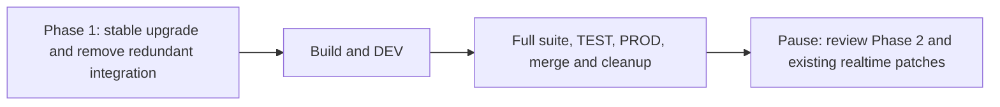
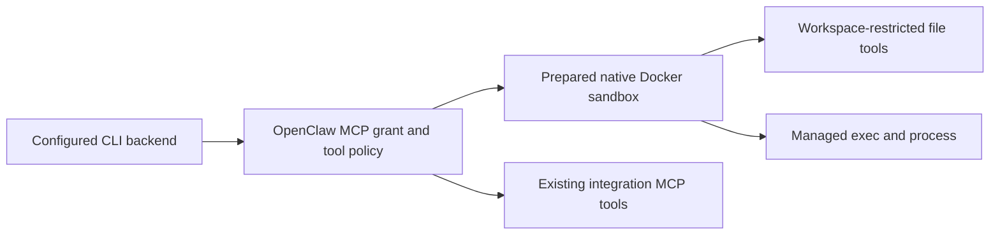

# Stable upgrade and native CLI voice controls

Status: Phase 1 production approved with one sandbox handoff patch; pause before Phase 2
Issue: https://github.com/coletaylor788/puddles/issues/359
Last updated: 2026-11-15

## Human section

### Design

Upgrade to **OpenClaw v2026.11.3**, use native CLI execution and remove redundant
integration patches. Preserve current integrations, sessions, permissions and
sandboxing. Finish that production release, then pause for review of realtime delegation,
steering and all existing realtime patches.

The release API still identifies v2026.11.3 as latest stable. Newer main contains
additional fixes, but moving main is not the proposed deployment target.

#### Phase 1: use native behavior

The registered CLI backend runs the selected local CLI using its native login.
Model configuration selects the runtime. This route is distinct from ACP and
does not require replacing native subscription authentication with API billing.
Include the approved native CLI update in the immutable application artifact;
each environment uses its own copy. Preserve the user's normal launcher and
existing sign-in profile.

| Capability | Native behavior to adopt |
| --- | --- |
| Model execution | Registered backend, model runtime selection, native authentication and session binding. |
| Tools and configured MCP | Policy-filtered OpenClaw catalog, exact run grants, server instructions and native cleanup. |
| Managed Claude file and shell tools | OpenClaw file controls and execution tools through MCP; native file/Bash tools are disabled on ordinary managed turns. |
| Steering and cancellation | CLI text injection with current-authority checks, consumption receipts and native cancellation. |
| Long shell commands | Managed exec/process handles and originating-conversation completion notifications. |
| Compaction | CLI-owned compaction and supported native manual control. Additional memory snapshot behavior remains separate. |
| Workshop | Immediate skill saves, version history, undo and native pending-draft export, preserving existing access limits. |

Stable also contains fixes for private child-completion streaming and replacement
work after a cancelled child's handoff. It does not contain newer main's unified
session controller or injected child-result context fix. Do not count those as
stable benefits or claim the complete realtime scenario is already repaired.

#### Sandbox handoff repair

Keep the ordinary OpenClaw Docker sandbox and managed exec/process tools. The
CLI stays on the Gateway, where it calls OpenClaw tools through the existing
MCP grant. One approved source patch supplies those tools with the prepared
session sandbox. No additional node service, custom message routing or native
Bash bypass is introduced.

Adapt upstream [PR #163238](https://github.com/openclaw/openclaw/pull/163238)
to the pinned stable APIs. Prepare the sandbox only when the effective coding
tool surface needs it. Keep its lifetime with the native run/grant owner, bind
both files and shell to it, and fail closed on preparation failure. Preserve
workspace restrictions, read-only modes and authority revocation at the final
operation. Existing background command handles and completion notifications
remain native OpenClaw behavior.

Review every upstream comment and inline finding. Incorporate relevant fixes;
record evidence for findings that do not apply. Preserve existing backend removal
semantics, including literal tilde paths and recursive limits. Do not copy older
PR code over newer stable ownership/disposal APIs. Unsupported third-party
bridges must not silently acquire mutation authority. Tests must cover the full
CLI/Gateway path as well as backend units, failure and cleanup.

The previously tested Docker-node route is feasibility evidence only and is not
the selected design. Existing native CLI child/cron admission restrictions stay
intact; this patch does not bypass them or expand runtime placement authority.

#### Native history and permission compatibility

Stable can launch Claude with a dedicated `CLAUDE_CONFIG_DIR`, but some history
readers still assume the default directory. Upstream merged
[PR #175549](https://github.com/openclaw/openclaw/pull/175549) fixes that recovery
path. The harness/history follow-up category will evaluate this native replacement
after both phases, with cold resume, history and compaction proofs. Bind the existing login root in
the Gateway environment. The upstream fix uses it only without an explicit
offline `homeDir`; check Doctor, TUI and cold/history callers before retiring
profile plumbing. It is not part of v2026.11.3. Keep credentials in their existing
native profile.

Workspace-only policy is a hard boundary. It does not reproduce our old
allow-once outside-file approval sequence. Prefer native confinement and explicit
resources over rebuilding that mechanism just to satisfy an implementation-shaped
test. The approved native boundary applies to diagnostic tools too: shell execution
uses the ordinary Docker sandbox and file tools stay inside their workspace.
Existing MCP role permissions remain. Arbitrary host diagnostics and outside-file
approval are retired; protected paths outside the workspace remain inaccessible.

#### Phase 1 patch retirement

The requester approved removing seven public test-only overlays:
`native-parent-continuation`, `sandbox-discovery-failure-fix`,
`builtin-memory-migration`, `silent-reply-completion-evidence`,
`active-memory-cold-recall`, `active-memory-fixture-cleanup`, and
`gateway-protocol-declaration-portability`.

Also remove `imessage-group-inbound-policy` (unselected behavior) and
`scoped-container-temp-root` (used only by test helpers). Native regressions stay
selected independently of patch records. Tests use native secure temporary
staging. These removals introduce no replacement overlays. The separately approved
sandbox handoff is the only new runtime patch.

`talk-agent-parity` and obsolete Workshop proposal compatibility were already
retired in this candidate; do not count them again. Other audit reductions are
reserved for independent work after both phases, unless separately required and
approved for the realtime repair. Preserve their existing behavior meanwhile.

#### Deferred behavior categories

- Deployment and process lifecycle.
- Talk, realtime and FaceTime.
- Memory and compaction.
- Messaging and delegation.
- Tools, MCP and sandbox policy.
- Harness sessions, credentials and request ownership.
- Model configuration, skills and accounting.

A category is assigned only when the requester asks. Each gets its own design,
qualification and development lifecycle. A broad patch may span categories;
coordinate its consumed hunks before changing it. “Reduce” or “unproven” in the
audit does not mean unconditional removal in Phase 1.

#### CI and upgrade acceptance

Adapt CI to the new native lifecycle. DEV and TEST use normal isolated Gateway
startup and recording fixtures. Held PROD uses native startup canary behavior.
Installed plugin metadata does not establish runtime loading or authentication;
the same artifact must pass full authenticated TEST acceptance first.

Qualify the complete application: integrations, subscription login, exact tool
policy, files and shell, unavailable-sandbox refusal, session/cold continuation,
steering and cancellation, memory, compaction, migrations and cleanup. Include
ordinary and restricted turns, existing delegated admission/refusal, and
supported completion paths. Test observable behavior rather than a required
Claude-native tool name. Keep unresolved permissions as failing
acceptance gates until the reviewed behavior has a durable regression.

Preserve and rebase both source branches on current main. Use installed `build`,
`ci-dev` and `ci-prod`, with retained independent review and required checks.
Yield after dispatch; CI owns deployment, full tests, TEST, backup, PROD, merge,
recovery and cleanup. A passed workflow is not a terminal deployment receipt.
Recovery keeps the current CLI baseline and never overwrites new live writes
or restores an older runtime over migrated state.

#### Phase 2: realtime coordination

After Phase 1 production, merge and cleanup close, pause for requester review
of the proposed repair together with all existing realtime patches. Do not
implement Phase 2 until that discussion produces renewed approval. The prior
proposal is retained below for discussion:

1. Route Talk through the agent's configured runtime while retaining its caller,
   session and asynchronous result ownership.
2. Connect Talk steering, coordinator guidance and child completion to the same
   native CLI execution and guarded controls. Keep one result claim and native
   continuation after yield.
3. Preserve each injected input's context and provenance so a child result is
   consumed as a completion, including while the parent is busy.

Use native sessions, controls and delivery. Do not retain the first repair's
CLI-ready switches or steering refusal, add a second message queue, or replace
steering with cancellation/restart.

Prove one continuous scenario: delegate research, keep talking, steer the same
task, and receive the corrected result proactively after completion, whether
the parent is busy or yielded. Require real native CLI execution, permissions,
no duplicate work and one result through browser and FaceTime. Repeat the full
build, DEV, TEST, PROD, merge and cleanup lifecycle independently.

#### Supporting Node interpreter update

Use Node 26.13.1 for CI, builds and the upgraded Gateway. Node 26.1 has a SQLite
column-metadata bug after schema changes; the unchanged database recovery test
exposes it. Node's [upstream fix](https://github.com/nodejs/node/pull/64219) is
included from 26.6.0 onward. A minimal reproduction and the unchanged recovery
test pass with the checksum-verified 26.13.1 binary.

Stage the new interpreter alongside the old one. Adopt it for CI only while
both hosts are idle, with consistent workflow and service bindings. The Gateway
switch belongs to the normal stopped deployment and backup lifecycle. Preserve
both normal and held service definitions in the backup and verify their exact
interpreter after deployment. Keep unrelated explicit tool launchers unchanged.
The new interpreter requires a fresh candidate, DEV and full production gate.

#### Proposed test fixture correction, awaiting approval

The retained `untrusted-agent-results.patch` adds a configuration read to the
reply flow. Three native delegation tests do not supply that configuration. The
patched flow rejects immediately, while the test waits for a callback that never
occurs. Native test isolation reproduces the failure. This is compatibility with
our retained patch, not an independent upstream test defect.

Propose one test-only adaptation in that retained patch: pass
`config: context.getRuntimeConfig()`
to this fixture's `runSessionsSendA2AFlow` call. The retained patch already adds this
parameter. The same Gateway test context then supplies its configuration, while
all disconnect, revocation and reply assertions remain intact. No runtime code,
timeout or selected test changes. Do not restore the retired preload patch.
This correction is proposed separately from the approved patch removals and is
not implemented until the requester approves it.

### Status

**Approval:** Production approved for Phase 1, including the stable and CLI
upgrade, the 12 approved removals, and one sandbox handoff patch adapted from
upstream PR #163238. All other patch categories remain deferred.
**Approval reference:** On 2026-11-15 the requester approved the proposal plus
this one patch, required every upstream review finding to be incorporated or
dismissed with evidence, and instructed: "Implement, push, and ship."
**Stop condition:** The requester then instructed us to pause after Phase 1
successfully lands in production. Complete production validation, exact merge
and CI cleanup, then stop. Phase 2 requires further discussion of all realtime
patches and is not authorized to start automatically.

**Progress:** The upgrade passed DEV and terminal cleanup. Production CI stopped
before deployment when the combined native test process exhausted its heap. CI
now runs original native test projects in separate, sequential processes, retaining
all tests and each project's setup, worker policy and teardown. This CI-only
change is reviewed. Native execution exposed a stale macOS port-range assertion
in the retained service-lifecycle patch; the corrected test passes all 23 cases.
The remaining native projects are being qualified. Three native Gateway tests
now fail because the retained results patch needs explicit fixture configuration; the correction
above awaits approval. The exact OOM trigger remains uncertain. Production is
unchanged; Phase 2 remains paused.

## Agent section

### Sources and findings

Stable target: `847611dcaa3bf0e2783335f961dd1fd0580e4d9f` (v2026.11.3).
The GitHub latest-release API was reconfirmed 2026-11-15. The earlier source pin
was `eb377ac59e6c9fd6c7705028034812becf00271b`. Read the pinned native
`docs/gateway/cli-backends.md`; the website fetch failed in this environment.
Newer main was inspected at `5370661901a61a4aa5c7e9f76174e50eb1ee597b`.

| Source | Use and limitation |
| --- | --- |
| [CLI backend guide](https://docs.openclaw.ai/gateway/cli-backends) | Runtime selection, managed MCP tools, isolation, sessions and compaction. Use the pinned-source copy for stable behavior. |
| [Sandbox PR #163238](https://github.com/openclaw/openclaw/pull/163238) | Open proposal for prepared sandbox capability and grant binding. Inspected head `3033c7d66ef3f2b500abe406e0e4ca4666eb15ff`; not shipped stable. |
| [History PR #175549](https://github.com/openclaw/openclaw/pull/175549) | Merged commit `08d89a8bdf54785bb869994203f43985abc7efa1`; honors config root in transcript recovery. Not shipped stable. |
| [Sandbox hooks PR #191205](https://github.com/openclaw/openclaw/pull/191205) | Embedded attempt hook metadata; distinct from the CLI coding-tool handoff. |
| [Native CLI steering #159816](https://github.com/openclaw/openclaw/pull/159816) | Stable native steering; existing focused transport and receipt tests passed. |
| [Input context #185945](https://github.com/openclaw/openclaw/pull/185945) | Newer-main context/provenance evidence for Phase 2, not an upgrade benefit. |
| [Coordinator steering #178865](https://github.com/openclaw/openclaw/pull/178865) | Main ownership/control evidence; not permission to bypass stable admission. |
| [Talk routing #164229](https://github.com/openclaw/openclaw/pull/164229) and [phone routing #191683](https://github.com/openclaw/openclaw/pull/191683) | Routing and lifetime cases; neither proves the complete approved scenario. |

The sandbox runtime reproduction used composed output. Stock causality was
checked separately: `prepare-tool-policy.ts` is unchanged at the controlling
ordinary mediation logic; `gateway/tool-resolution.ts` resolves sandbox status
without handing `SandboxContext` to `createOpenClawCodingToolsInternalAsync`;
exec rejects the absent sandbox. Native managed tool configuration accepts only
Agent/Workflow, not Bash. Do not describe the reproduction as a clean stock build.

The native delegated child-plan sandbox/CLI tests pass by denying those children.
This is a safe refusal, not successful delegated CLI execution. Do not expand
admission without a reviewed containment and authority contract.

### Patch and configuration implementation

Keep the removal list, patch order, digests and direct native regression targets
synchronized. Preserve the existing profile, configured-MCP and additive scripting
patches while their category work is deferred. Do not implement earlier proposed
shrinks or history substitutions merely because the old audit suggested them.
Keep credentials in the existing profile and protect retained recovery state.

Workshop uses native edits, version history and Doctor export. Preserve agent
access and the existing sandbox construction bridge. Retire obsolete approval
settings through the declared stopped-state migration. Talk setting retirement
is a separate exact-value migration. Keep recovery captures and bounded Doctor
execution; no manual deletion of recovery data.

### Validation and release sequence

Retain earlier successful evidence only for unchanged inputs. Local composition,
runtime/test types, plugin suites and focused native tests have passed in this
workstream. The last installed integration group passed 9/9; it did not qualify
all subscription-tool behavior. Native workspace confinement passed the real
Gateway fixture in 16.46 seconds. Docker exec was refused for lack of runtime
context. The separate configured-node route passed actual stock Gateway/MCP to
Docker-node execution, workspace file confinement, configured MCP coexistence,
host/node override rejection and disconnected-node refusal. This is isolated
route qualification, not acceptance of the rebuilt upgrade artifact.

1. Implement the approved sandbox handoff patch and all applicable upstream
   review fixes. Preserve native admission; enforce the requested sandbox and
   workspace boundaries using existing configuration.
2. Implement approved reductions and replacements. Keep cumulative tests,
   patch order and digests coherent. Do not patch prepared distribution chunks.
3. Update fixtures for native MCP names and parameter shapes. Use Docker-visible
   paths and test-owned sentinels; verify execution location, read-only access,
   unavailable backend, revocation and absence of host fallback.
4. Requalify login, cold/warm history, policy intersections, compaction,
   continuation, integrations and existing-state migration. Keep external
   mutations and message delivery on explicit recording adapters.
5. Preserve/rebase source on fresh main, complete retained independent review,
   required checks and sealed build. Dispatch DEV and yield. Inspect actual
   terminal deployment and source cleanup before production submission.
6. CI runs full application tests, TEST, backup, PROD, exact source merge and
   cleanup. Stop there for the requested Phase 2 and realtime-patch review.

CI startup adaptation remains application qualification work. Normal DEV/TEST
and held PROD canary must preserve exact artifact/configuration bindings and
read-only production checks. Never equate plugin metadata with active runtime.
The requester rejected the proposed canary profile-initialization patch; it
was not implemented. Current lifecycle details are in
[triggered CI](../../packages/release/CI.md).

### Review and approval record

The retained reviewer previously cleared composition ports, packaging, CI
startup compatibility and fixture repairs. Its newer three-patch audit found
removable profile/MCP code, a remaining history gap and no native Code Mode
replacement. Those findings inform this redraft; earlier clearance does not
approve its new sandbox backport or policy changes.

The requester's two-phase instruction remains controlling. The earlier custom
protection either/or question was withdrawn and is not an outstanding gate.
This revised proposal separates existing approval from new compatibility choices.
No phase completion or production qualification is claimed by this document.

### Approved sandbox implementation checkpoint

Assess all feedback on PR #163238 against stable847611 and the reduced 35-patch
base. Add one reviewed patch and its cumulative regressions. Preserve native
background process ownership, sandbox image/network configuration and scoped
MCP integrations. No Docker-node topology or native child admission bypass.

### Sandbox handoff qualification checkpoint

The new patch carries the complete native sandbox owner from CLI preparation
through the host-only MCP grant. All accessible upstream review edits were
assessed in the [feedback ledger](../openclaw-setup/patches/cli-sandbox-handoff.md).
The retained reviewer cleared the complete source and exact patch export.
The ordered 36-patch composition passes at the pinned stable base. Nine public
manifest checks pass. Native backend checks cover capability provenance, final
launch fencing, real grant revocation, and existing removal semantics.
The combined CLI, Gateway and native admission run passes all 220 tests. Core,
extension and affected test types pass. The installed check passes 23 operations
across four real agent containers in 54.944 seconds, including native background
completion, direct and nested MCP, read-only mounts, role limits and cleanup.
Inference in that focused fixture is synthetic. DEV subscription and boundary
qualification passed on candidate `e50b0e6f5aad76d6f04e71e32c7d40418a4a0e2622fb4ccaddde6be1980416f0`.
Its production workflow stopped before target deployment because two retained
regressions were assigned to the wrong native projects. `review-undo` belongs to
`unit`; `legacy-config-migrations.runtime.skills` belongs to `unit-fast`. Both
remain selected and their 12 cases pass. This changes CI metadata only.
No production acceptance or Phase 2 work is claimed.

### Pending Gateway fixture correction evidence

The original Gateway project ran five files: 149 tests passed and three requester
lifetime cases timed out. Each unhandled rejection reports `Runtime config is not
prepared` from the A2A flow call in
`src/gateway/server-plugin-in-process-dispatch.continuation.test.ts`. The fixture
awaits `waitStarted` before observing the rejected reply-flow Promise. A native
`--isolate` diagnostic reproduced the same three errors with the other 149 tests
passing. It used a shorter timeout only to bound diagnosis, not as release proof.
The retired preload overlay is not the fix and remains removed.

The retained reviewer compared the exact unpatched source. The new config
parameter and read come from `untrusted-agent-results.patch`, so this is our
compatibility obligation. The latest-release API was checked during this repair;
v2026.11.4 was published 2026-11-16 UTC. Its unchanged test does not establish an
upstream defect. The approved upgrade remains pinned to v2026.11.3. Proposed
delta is one explicit `config` argument in the retained patch's test adaptation;
no source patch or prepared-source edit has been applied. Approval was
requested in the task conversation. Remaining native projects continue separately;
the failed Gateway project stays explicitly blocked and is not counted as passed.

### Node and provider qualification follow-up

A two-connection SQLite reproduction fails with Node 26.1.0 and succeeds with
26.13.1 without loading OpenClaw. The unchanged native Doctor migration file
passes all three cases on 26.13.1. Official archive SHA-256:
`aec2514ea1ceb2ba52455e9ec65986f6749a06dd759e5db2a72e6889668c9735`.
Executable SHA-256:
`266dec4dce3a6cdcf5cdc38722a00cf5ae6a12cc51068d2a227655bbb75751ec`.
Staging is not activation. CI tooling and stopped Gateway activation remain
separate changes with their own review and verification.

A misplaced provider header test addition was removed from the retained
companion patch. Its existing Responses case again checks the native headers;
all dedicated Anthropic header cases remain. Seven provider files pass all 175
cases on the newer Node, and retained review is clear. Ordered composition of
all 36 patches and the 21 companion metadata checks pass.

All other mapped projects completed during diagnosis. These runs used both
interpreter versions and are not a fresh candidate's full-suite receipt. The
three Gateway continuation cases remain blocked on the proposed explicit fixture
configuration. No new build or DEV submission has been made for these repairs.
