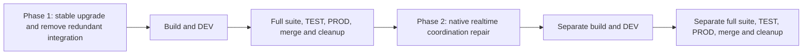
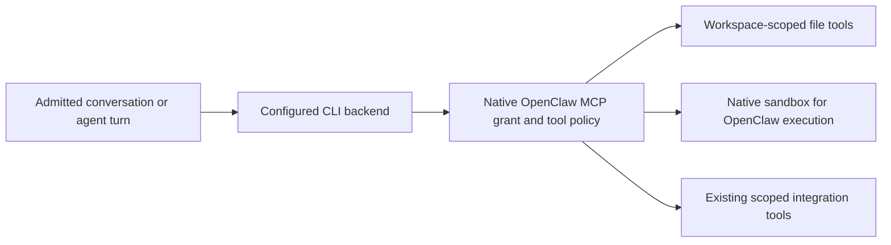

# Stable upgrade and native CLI voice controls

Status: Two-phase release approved; revised upgrade compatibility scope proposed
Issue: https://github.com/coletaylor788/puddles/issues/359
Last updated: 2026-11-15

## Human section

### Design

Upgrade to **OpenClaw v2026.11.3**, use native CLI execution and remove redundant
integration patches. Preserve current integrations, sessions, permissions and
sandboxing. Finish that production release before implementing and releasing
the remaining realtime delegation and steering repair.

The release API still identifies v2026.11.3 as latest stable. Newer main contains
additional fixes, but moving main is not the proposed deployment target.

#### Phase 1: use native behavior

The registered CLI backend runs the selected local CLI using its native login.
Model configuration selects the runtime. This route is distinct from ACP and
does not require replacing native subscription authentication with API billing.
Include the approved native CLI update in the immutable application artifact;
each environment uses its own copy. Preserve the user's normal launcher and
existing sign-in profile.

| Capability | Native behavior to adopt |
| --- | --- |
| Model execution | Registered backend, model runtime selection, native authentication and session binding. |
| Tools and configured MCP | Policy-filtered OpenClaw catalog, exact run grants, server instructions and native cleanup. |
| Managed Claude file and shell tools | OpenClaw file controls and execution tools through MCP; native file/Bash tools are disabled on ordinary managed turns. |
| Steering and cancellation | CLI text injection with current-authority checks, consumption receipts and native cancellation. |
| Long shell commands | Managed exec/process handles and originating-conversation completion notifications. |
| Compaction | CLI-owned compaction and supported native manual control. Additional memory snapshot behavior remains separate. |
| Workshop | Immediate skill saves, version history, undo and native pending-draft export, preserving existing access limits. |

Stable also contains fixes for private child-completion streaming and replacement
work after a cancelled child's handoff. It does not contain newer main's unified
session controller or injected child-result context fix. Do not count those as
stable benefits or claim the complete realtime scenario is already repaired.

#### Sandbox contract and discovered gap

Use Docker for OpenClaw shell execution in this deployment. If a supported
execution route offers Claude Code's own shell, it must use Claude's native
sandbox. The Gateway and CLI can remain on the trusted host; this does not mean
external MCP servers inherit Claude's shell sandbox.

Native `tools.fs.workspaceOnly: true` passed a full-Gateway file test: inside
writes succeed and outside writes fail. That setting does not contain arbitrary
shell commands. A required sandbox must fail closed if unavailable.

The installed shell test exposed a native handoff gap. Tool resolution knows the
session is sandboxed but does not supply a prepared sandbox to the mediated
coding-tool factory. `exec` with `host=sandbox` is refused. No unsandboxed shell
fallback occurred. Renaming the old test's expected tool cannot fix this.

**Proposed compatibility change:** use the approach in upstream
[PR #163238](https://github.com/openclaw/openclaw/pull/163238). Prepare the sandbox
for admitted coding tools, retain it in the host-owned grant, and bind native
coding tools to it. Preserve current authority, invocation revocation,
read-only workspaces and cleanup. Do not add an executor, restore native Bash
by bypassing managed tool policy, or change the message-delivery path.

That PR is open and spans multiple sandbox backends. Review the exact
stable-compatible scope before implementation; the whole PR is not automatically
approved. A sandboxed run without a prepared sandbox must receive no mediated
coding tools. A filesystem bridge unable to check invocation authority after
awaited path and backend preparation must not expose write/edit/apply_patch.
Preserve these fail-closed rules and stable sandbox ownership/disposal. Separate
native rules reject sandbox-classified delegated CLI children and isolated CLI
automations. The handoff fix alone does not prove safe admission for those children.
Working delegation remains a release gate, not a reason to bypass the rule.

#### Native history and permission compatibility

Stable can launch Claude with a dedicated `CLAUDE_CONFIG_DIR`, but some history
readers still assume the default directory. Upstream merged
[PR #175549](https://github.com/openclaw/openclaw/pull/175549) fixes that recovery
path. Propose using the narrow upstream fix instead of custom directory plumbing,
with cold resume, history and compaction proofs. Bind the existing login root in
the Gateway environment. The upstream fix uses it only without an explicit
offline `homeDir`; check Doctor, TUI and cold/history callers before retiring
profile plumbing. It is not part of v2026.11.3. Keep credentials in their existing
native profile.

Workspace-only policy is a hard boundary. It does not reproduce our old
allow-once outside-file approval sequence. Prefer native confinement and explicit
resources over rebuilding that mechanism just to satisfy an implementation-shaped
test. Record any resulting access change before implementation. Existing
unsandboxed diagnostic access needs an explicit equivalent policy; do not
silently remove protected-path restrictions, widen it, or call it sandboxed.

#### Patches we will keep

Keep these existing capabilities through the upgrade, with cumulative regression
coverage. This is a preservation inventory, not a claim that every current hunk
is irreducible.

| Patch or group | Retained behavior |
| --- | --- |
| `code-mode-additive-surface`, `claude-code-mode-mcp`, `copilot-configured-mcp` | Direct tools plus contained scripting, nested policy, parked calls and grant-owned cleanup. Native MCP transport does not replace these additions. |
| Reduced `claude-native-agent-profiles` remainder | Only required credential clearing, profile continuity and independent callback behavior until native replacement is proved. |
| Memory and wiki | Detached snapshots, idle maintenance, persistent memory and citation metadata beyond native compaction. |
| Existing conversation, delegation and trust patches | Shared context, active tool ownership, result provenance, announcements and heartbeat behavior. |
| Talk and FaceTime | Existing voice transport, progress, overlap recovery and accepted-work lifetime. New realtime integration work remains Phase 2. |
| iMessage and browser | Message coalescing, group policy, profile lifecycle and singleton cleanup. |
| Deployment and sandbox support | Joined services, lock recovery, stopped-state migration, private staging, portability and existing sandbox Workshop access. |
| Native regression patches | Tests for behavior now owned upstream, including migration, discovery and continuation. These do not all modify runtime code. |

#### Patches and custom behavior we will remove

- **`talk-agent-parity.patch`:** already removed from the candidate. Use native
  approvals and detached-work admission; retain lifetime regressions.
- **Redundant Claude profile mechanics:** remove custom native permission phases,
  exec-default overrides, workspace argv settings and cap plumbing after native
  access and credential equivalence is proved. Retain only justified remainders.
- **`claude-configured-mcp.patch`:** propose native filtering and omission with
  diagnostics on server failure, replacing profile preauthorization and the
  stricter exception rethrow. Preserve denied-tool, grant and cleanup coverage.
- **Obsolete Workshop proposal compatibility:** use native immediate saves,
  history, undo and draft export; retain the existing sandbox access bridge.

Custom configured-MCP grant fields and its old resolver are already gone from
this candidate. The rejected canary profile-initialization patch was never
implemented. Neither should be counted as a new removal.

#### CI and upgrade acceptance

Adapt CI to the new native lifecycle. DEV and TEST use normal isolated Gateway
startup and recording fixtures. Held PROD uses native startup canary behavior.
Installed plugin metadata does not establish runtime loading or authentication;
the same artifact must pass full authenticated TEST acceptance first.

Qualify the complete application: integrations, subscription login, exact tool
policy, files and shell, unavailable-sandbox refusal, session/cold continuation,
steering and cancellation, memory, compaction, migrations and cleanup. Include
ordinary, restricted and delegated execution. Test observable behavior rather
than a required Claude-native tool name. Keep unresolved permissions as failing
acceptance gates until the reviewed behavior has a durable regression.

Preserve and rebase both source branches on current main. Use installed `build`,
`ci-dev` and `ci-prod`, with retained independent review and required checks.
Yield after dispatch; CI owns deployment, full tests, TEST, backup, PROD, merge,
recovery and cleanup. A passed workflow is not a terminal deployment receipt.
Recovery keeps the current CLI baseline and never overwrites new live writes
or restores an older runtime over migrated state.

#### Phase 2: realtime coordination

After Phase 1 production, merge and cleanup close, start from that landed
baseline with a separate candidate. The repair will:

1. Route Talk through the agent's configured runtime while retaining its caller,
   session and asynchronous result ownership.
2. Connect Talk steering, coordinator guidance and child completion to the same
   native CLI execution and guarded controls. Keep one result claim and native
   continuation after yield.
3. Preserve each injected input's context and provenance so a child result is
   consumed as a completion, including while the parent is busy.

Use native sessions, controls and delivery. Do not retain the first repair's
CLI-ready switches or steering refusal, add a second message queue, or replace
steering with cancellation/restart.

Prove one continuous scenario: delegate research, keep talking, steer the same
task, and receive the corrected result proactively after completion, whether
the parent is busy or yielded. Require real native CLI execution, permissions,
no duplicate work and one result through browser and FaceTime. Repeat the full
build, DEV, TEST, PROD, merge and cleanup lifecycle independently.

### Status

**Existing approval:** Production approved in two independent phases. The
requester's 2026-11-13 instruction approved implementation and shipping within
that design, with upgrade preservation first. Native Workshop adoption and the
configured CLI update were subsequently approved. The requester also requires
sandboxing at the execution owner and retirement of redundant patches.

**Revised scope:** Proposed for review. The new sandbox backport, upstream history
substitution, server-failure semantics and outside-workspace policy are not
recorded as newly approved. Delegated/automation CLI admission and diagnostic policy remain
open. The request to redraft this proposal is not approval of an unseen patch.
Independent investigation and qualification within existing approval may continue.

**Progress:** Latest DEV passed its installed integration group and native
login/startup, then failed the old native-Write assertion. Subsequent local
proofs established workspace confinement and reproduced the sandbox handoff
failure. The focused patch audit is complete. No additional runtime patch
removals or successor deployment resulted from the audit. Phase 2 has not begun.

## Agent section

### Sources and findings

Stable target: `847611dcaa3bf0e2783335f961dd1fd0580e4d9f` (v2026.11.3).
The GitHub latest-release API was reconfirmed 2026-11-15. The earlier source pin
was `eb377ac59e6c9fd6c7705028034812becf00271b`. Read the pinned native
`docs/gateway/cli-backends.md`; the website fetch failed in this environment.
Newer main was inspected at `5370661901a61a4aa5c7e9f76174e50eb1ee597b`.

| Source | Use and limitation |
| --- | --- |
| [CLI backend guide](https://docs.openclaw.ai/gateway/cli-backends) | Runtime selection, managed MCP tools, isolation, sessions and compaction. Use the pinned-source copy for stable behavior. |
| [Sandbox PR #163238](https://github.com/openclaw/openclaw/pull/163238) | Open proposal for prepared sandbox capability and grant binding. Inspected head `3033c7d66ef3f2b500abe406e0e4ca4666eb15ff`; not shipped stable. |
| [History PR #175549](https://github.com/openclaw/openclaw/pull/175549) | Merged commit `08d89a8bdf54785bb869994203f43985abc7efa1`; honors config root in transcript recovery. Not shipped stable. |
| [Sandbox hooks PR #191205](https://github.com/openclaw/openclaw/pull/191205) | Embedded attempt hook metadata; distinct from the CLI coding-tool handoff. |
| [Native CLI steering #159816](https://github.com/openclaw/openclaw/pull/159816) | Stable native steering; existing focused transport and receipt tests passed. |
| [Input context #185945](https://github.com/openclaw/openclaw/pull/185945) | Newer-main context/provenance evidence for Phase 2, not an upgrade benefit. |
| [Coordinator steering #178865](https://github.com/openclaw/openclaw/pull/178865) | Main ownership/control evidence; not permission to bypass stable admission. |
| [Talk routing #164229](https://github.com/openclaw/openclaw/pull/164229) and [phone routing #191683](https://github.com/openclaw/openclaw/pull/191683) | Routing and lifetime cases; neither proves the complete approved scenario. |

The sandbox runtime reproduction used composed output. Stock causality was
checked separately: `prepare-tool-policy.ts` is unchanged at the controlling
ordinary mediation logic; `gateway/tool-resolution.ts` resolves sandbox status
without handing `SandboxContext` to `createOpenClawCodingToolsInternalAsync`;
exec rejects the absent sandbox. Native managed tool configuration accepts only
Agent/Workflow, not Bash. Do not describe the reproduction as a clean stock build.

The native delegated child-plan sandbox/CLI tests pass by denying those children.
This is a safe refusal, not successful delegated CLI execution. Do not expand
admission without a reviewed containment and authority contract.

### Patch and configuration implementation

Keep the Human disposition table and the cumulative manifest synchronized.
`claude-configured-mcp` already uses the native catalog/grant APIs. Its remaining
runtime differences are profile exact grants and exceptional-error propagation.
The proposed removal adopts native warning-and-omission behavior; test it as an
intentional behavior decision, not a claimed byte-for-byte equivalent.

`claude-native-agent-profiles` includes independent environment, history,
callback and permission changes. Remove only the redundant portions after
qualifying native policy. The upstream history fix is a candidate replacement,
not permission to move login state. Compare inherited credential sanitization.
Do not discard cold-history or compaction coverage when shrinking the patch.

`claude-code-mode-mcp` still supplies an additive execution surface. Preserve
current policy lookup, grant identity, nested hooks/approvals, result capture,
parked-call cleanup and selected-skill authority. Native MCP transport does not
establish a replacement for these capabilities.

Workshop uses native edits, version history and Doctor export. Preserve agent
access and the existing sandbox construction bridge. Retire obsolete approval
settings through the declared stopped-state migration. Talk setting retirement
is a separate exact-value migration. Keep recovery captures and bounded Doctor
execution; no manual deletion of recovery data.

### Validation and release sequence

Retain earlier successful evidence only for unchanged inputs. Local composition,
runtime/test types, plugin suites and focused native tests have passed in this
workstream. The last installed integration group passed 9/9; it did not qualify
all subscription-tool behavior. Native workspace confinement passed the real
Gateway fixture in 16.46 seconds. Docker exec was refused for lack of runtime
context. No positive shell containment result is claimed for that route.

1. Review the concrete compatibility scope and resolve delegated admission and
   diagnostic/outside-workspace semantics. Record exact patch authorization.
2. Implement approved reductions and replacements. Keep cumulative tests,
   patch order and digests coherent. Do not patch prepared distribution chunks.
3. Update fixtures for native MCP names and parameter shapes. Use Docker-visible
   paths and test-owned sentinels; verify execution location, read-only access,
   unavailable backend, revocation and absence of host fallback.
4. Requalify login, cold/warm history, policy intersections, compaction,
   continuation, integrations and existing-state migration. Keep external
   mutations and message delivery on explicit recording adapters.
5. Preserve/rebase source on fresh main, complete retained independent review,
   required checks and sealed build. Dispatch DEV and yield. Inspect actual
   terminal deployment and source cleanup before production submission.
6. CI runs full application tests, TEST, backup, PROD, exact source merge and
   cleanup. Phase 2 may start only after those Phase 1 receipts close.

CI startup adaptation remains application qualification work. Normal DEV/TEST
and held PROD canary must preserve exact artifact/configuration bindings and
read-only production checks. Never equate plugin metadata with active runtime.
The requester rejected the proposed canary profile-initialization patch; it
was not implemented. Current lifecycle details are in
[triggered CI](../../packages/release/CI.md).

### Review and approval record

The retained reviewer previously cleared composition ports, packaging, CI
startup compatibility and fixture repairs. Its newer three-patch audit found
removable profile/MCP code, a remaining history gap and no native Code Mode
replacement. Those findings inform this redraft; earlier clearance does not
approve its new sandbox backport or policy changes.

The requester's two-phase instruction remains controlling. The earlier custom
protection either/or question was withdrawn and is not an outstanding gate.
This revised proposal separates existing approval from new compatibility choices.
No phase completion or production qualification is claimed by this document.
