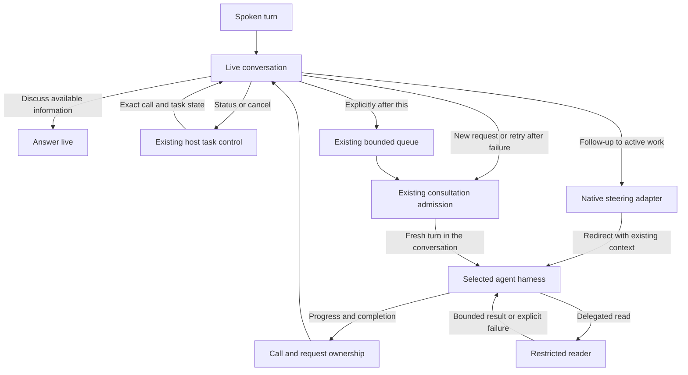

# Voice task control across harnesses

Status: Proposed; runtime compatibility partly validated
Issue: [#290](https://github.com/coletaylor788/puddles/issues/290)
Last updated: 2026-10-14

## Human section

### Design

Changing the agent harness does not repair the voice bridge around it. Voice can
mistake a status question for new work, reject a follow-up while work is active,
and describe that rejection as if the original task failed. A CLI harness also
uses a different run lifecycle from an embedded harness. Voice must retain the
right to deliver its result without depending on an embedded-only registration.

Give voice the same ability to continue a task as another text message: steer
active work, or send a fresh turn after completion or failure. Fix these shared
boundaries while qualifying the incoming harness. Do not invest in the outgoing
harness's input adapter or change reader behavior for voice.

#### What migration changes

The incoming CLI adapter supports sequential turns in a retained session and
cancellation. The inspected version rejects a concurrent second turn and does
not expose the guarded input interface used by Talk for mid-turn changes.
Session reuse is not the same capability as steering active work.

| Behavior | Effect of changing harness |
| --- | --- |
| Outgoing adapter's missing guarded input and receipt implementation | That implementation leaves the selected route. Do not repair it here. |
| Mid-turn follow-up | Requires native steering support in the OpenClaw adapter and exact-runtime validation. The inspected adapter rejects concurrent turns. |
| Status routed as another task | Unchanged. Classification happens before the harness. |
| Unnecessary delegation of discussion | Unchanged. The live voice model and its instructions remain. |
| Ordinary and delayed result delivery | Must be qualified. Talk currently claims completion through embedded-run registration. |
| Reader fetch truncation | Reader behavior remains its own concern. Voice must receive the outcome and remain able to send another request. |
| Subagent registry persistence failure | Migration does not repair shared persistence. Failure must settle voice control and allow a fresh request. |

These are source and isolated-adapter findings. They do not establish an
authenticated CLI turn, end-to-end Talk compatibility, or microphone acceptance.
Qualify the exact migration artifact before changing the voice agent's route.

#### Conversation and task control

Keep reasoning, explanation, brainstorming, and discussion of existing results
in the live model. This preserves [plan 055](055-live-conversation-default.md).
Make the boundary explicit with examples of discussion during a pending lookup
and discussion after a result arrives. Test actual model decisions as well as
the composed instructions.

A live status question needs a fresh host answer, not a new reasoning turn or a
guess from conversation history. Repair the existing control classification so
natural questions about whether a lookup was accepted or is still running reach
the status path. Preserve conservative cancellation and negation handling. Do
not treat a conversational word such as "also" as sufficient evidence of new
backend work. Prefer an explicit control intent where the provider supports it;
keep the existing raw-text path for the current native delegation protocol.

Keep current task identity and admission state in host-owned context. Distinguish
waiting to start, accepted/running, waiting for a child, completed, failed,
cancelled, and delivery unconfirmed. A rejection names the rejected follow-up
and preserves the original task's state. A receipt must not claim tool progress.
Do not announce that checking has started before admission succeeds.

#### Work arriving while busy

Follow-ups that correct, refine, or add context to active work should steer that
work. For example, "use the other document" should affect the current lookup
before it finishes. Do not silently turn this into an independent queued task.
Send the additional instruction with the existing task and conversation context.
Ordinary discussion and status checks still stay on their respective paths.

Use the incoming harness's native control interface through OpenClaw's adapter.
Streaming input alone is not proof of steering: the documented input stream
processes messages sequentially. The documented interrupt-and-continue operation
is a candidate for redirecting active work while retaining the session. It ends
the current model turn and starts a revised one in the same context; it does not
edit reasoning already generated. Qualify this behavior on the exact incoming
CLI before claiming that voice can steer it. Prefer an existing supported steer
operation if that version provides one. Do not fork the harness or add a broker.

The adapter must expose guarded steering and settle it with an explicit outcome.
Bind input to the current caller, call, task, and request ID. Keep tool authority
checks on the revised turn. When interruption is needed, consume the old turn's
terminal messages before accepting its replacement's result. Preserve useful
context while preventing an interrupted final answer from being delivered as the
new answer. A transport write alone does not prove the change was applied.
An already accepted external action is not undone by interrupting reasoning;
preserve its known or uncertain outcome and never replay it as part of steering.
Retain rapid corrections in order while native control settles, with bounded
admission and an explicit rejection on overflow. This short wait for control
must not become a wait for the original task to finish or overwrite an earlier
instruction. If interruption succeeds but continuation fails, report that exact
state; do not claim the original turn is still running or resend uncertain input.

If the task finishes before steering is admitted, submit the instruction once as
a normal next turn in the same conversation. If the parent has yielded to a child,
use the existing parent continuation path and retain child ownership. Do not
claim that steering the parent also changed the child's instructions. A bounded
failure or unsupported capability must return promptly and keep the call usable,
not hang on an embedded registration or silently defer the instruction.

Reserve the existing serial consultation queue for explicit sequencing such as
"after this, check the other document." Retain its bounded limits and request
identities, reject overflow explicitly, and never overwrite pending work. Tell
the caller when input is waiting. Only known-unaccepted input may be submitted
later; an unconfirmed receipt is not permission to send it again. Closing the
call drops unadmitted work and preserves existing accepted-work lifecycle rules.

#### Result ownership across runtimes

Bind voice completion to the existing admitted run and call lifecycle, with an
adapter for each supported backend kind. Retain exact caller, run, lifecycle,
and cancellation checks. A CLI turn must not need a fictitious embedded-run
registration to release a final answer. Readiness, failure, and cancellation
must settle pending control requests even when steering is unavailable.

Reuse the existing reply-operation and requester-final mechanisms. Qualify a
direct result and a result after a reader handoff. Deliver each once, discard
late output after cancellation or replacement, and preserve the established
accepted-work behavior after hangup. Do not weaken the completion claim merely
to make a CLI result appear.

#### Continuing after failure

Reader remains Reader. Its fetch limits, tools, output policy, and internal retry
behavior are outside this proposal. Let the parent handle a reader failure
normally, including its own recovery. While the parent is still working, voice
can steer it. Once the parent returns a result or failure, deliver that outcome
to voice and settle the attempt's ownership. Do not leave a failed attempt marked
busy or wait forever for a child that was not successfully launched.

The live model may send a fresh request when useful to fulfill the caller's
request, or when the caller says "try again." Include the earlier failure and any
revised instruction in the same conversation, just as another text message would.
This is a new turn with its own request identity, not retransmission of an input
whose delivery is unknown. It needs no voice-specific permission round trip and
does not promise that an unchanged reader limitation will disappear. Do not add
an automatic repeat-until-success loop.

Keep shared persistence diagnosis separate from this voice repair. Exercise a
failed child handoff and prove that voice receives its outcome and can continue.
Preserve existing durable handoff and uncertain-write rules. Fix a demonstrated
voice ownership or delivery defect here; do not require a reader or registry
redesign before voice can accept another message.

### Status

**Approval:** Proposed. **Approval reference:** On 2026-10-14 the requester asked
to validate what the incoming harness fixes and propose the remaining work,
with no investment in outgoing-harness-specific fixes. The requester then asked
for steering and text-like retries, excluding reader-limit changes. This
authorizes the revised proposal, not implementation of the new runtime changes.

Installed source inspection and an isolated transport-stub probe establish the
CLI adapter's sequential-turn, reuse, cancellation, stale-owner, and busy-turn
behavior. A pure installed classifier probe reproduces missed status requests
and an overly broad follow-up marker. No live inference, external tool calls,
production session writes, configuration changes, or deployment were performed.
The CLI completion claim mismatch is a source-level integration finding.
Official documentation establishes a native interrupt-and-continue operation;
its exact CLI/OpenClaw integration and authenticated voice path remain unqualified.

## Agent section

### State

This is a documentation-only proposal. Follow the short documentation path in
`safe-feature-development`. Runtime implementation and release start only after
approval. Preserve the outgoing adapter unchanged.

Related designs are [the CLI harness migration](claude-code-subscription-harness.md),
[voice progress](050-talk-conversation-progress.md), and
[live conversation](055-live-conversation-default.md). Keep private conversation
records, installed paths, artifact digests, and account information out of public
plans and issues. The requesting conversation holds the operational evidence.

### Scope and acceptance criteria

Qualify the selected CLI harness for initial work, controls, ordinary and delayed
completion. Repair shared voice classification, truthful admission feedback,
active-task steering, and admission of fresh turns after failure. Preserve
explicitly sequenced work with the existing bounded queue. Do not change the
outgoing harness, voice model, reader behavior or limits, or registry storage.
Do not add a scheduler or replay uncertain accepted work. The scenario table
below defines the behavior gate.

### Architecture and decisions

The inspected installed modules identify these upstream source locations:

- `extensions/anthropic/cli.runtime.ts`: `executeClaudeCli` rejects a live
  session with `currentTurn`, retains idle sessions, and exposes lifecycle
  methods rather than `messageInjectionV2`.
- `src/agents/cli-runner/execute.ts`: CLI reply handles attach cancellation;
  they do not register an embedded message-injection handle.
- `src/gateway/talk/client-agent-consult.ts`: steering awaits
  `owner.registered`; `claimAppend` requires a successful embedded completion
  claim. The registration is not a runtime-neutral readiness signal.
- `src/agents/embedded-agent-runner/runs.ts`: the completion claim is promoted
  by embedded registration. Guarded steering requires injection interface V2.
- `extensions/openai/realtime-quicksilver-delegation-controller.ts`: a single
  `pendingDelegation` can be replaced; the runner waits for steering before
  claiming its result; the initial acknowledgement precedes the runner call.
- `src/talk/agent-run-control-shared.ts`: conservative status patterns miss
  natural status formulations, while a leading follow-up marker can capture
  conversation. Retain the distinction between inferred mode and
  `shouldAutoControl`.
- `src/talk/agent-talkback-runtime.ts`: existing bounded serial consultation
  queue, to reuse rather than introduce another worker or scheduler.
- [Durable yield handoff](../openclaw-setup/patches/sessions-yield-durable-handoff.md):
  preserve existing publication and retry boundaries while surfacing failures.

Official [streaming-input documentation](https://code.claude.com/docs/en/agent-sdk/streaming-vs-single-mode)
describes sequential queued messages with interruption. The
[client interruption example](https://code.claude.com/docs/en/agent-sdk/python#claudesdkclient)
interrupts a turn, drains its terminal response, and submits another prompt in
the same client session. Buffered old messages remain after interruption. These
documented semantics inform the proposed adapter; they do not prove that the
installed OpenClaw transport supports the operation. Its current `send` writes
JSONL and its `close` tears down the process. Do not substitute `close` for native
interruption or merely remove the concurrent-turn guard.

This proposal adds native steering integration to the migration's existing
adapter, subject to approval and exact-version qualification. It preserves the
migration's tool and session boundaries and does not patch the harness itself.

Recheck these findings against the frozen migration artifact. Source locations
describe the inspected implementation, not a claim that another candidate has
the same limitations. Do not mistake the isolated transport-stub probe for a
test of the authenticated CLI process, native tool restrictions, or full Talk.

### Implementation

1. Freeze the incoming runtime and role routing. Add an end-to-end fixture for
   initial Talk admission, result ownership, status, cancellation, and a child
   result. Repair the shared lifecycle adapter where that fixture fails.
2. Repair control routing and admission messages. Test discussion and status
   while pending and after completion with the real voice model in isolated DEV.
3. Qualify native steering and connect it through guarded runtime control. Cover
   native interruption, old terminal messages, parent yield, completion races,
   and preserved tool authority. Unsupported steering must settle promptly.
4. Reuse the bounded queue only for explicit sequencing. Test ordering, overflow,
   duplicate receipts, uncertain admission, and call closure.
5. Exercise a reader failure and a failed child handoff through voice and text.
   Repair voice ownership or delivery so a fresh contextual request succeeds in
   reaching the harness in both cases. Keep reader and registry behavior intact.

### Validation

| Scenario | Required result |
| --- | --- |
| Begin a lookup, then brainstorm | One accepted lookup; discussion remains live. |
| Ask whether the lookup is running in several natural phrasings | Host status; zero new harness turns. |
| Discuss a returned result | Reuse it; no new retrieval or task-control operation. |
| Refine a running lookup | Native steering changes the task before original completion; context and authority retained. |
| Native interruption leaves buffered output | Drain old terminal output; only the revised turn supplies its final answer. |
| Two rapid corrections or a failed continuation after interruption | No silent overwrite or replay; each input gets an accurate admission outcome. |
| Follow-up races completion or arrives during child yield | One continuation with current ownership; no lost input or duplicate child launch. |
| Explicitly request two tasks after the current task | Both retained in order, or explicit bounded rejection; no silent overwrite. |
| Unsupported steering | Prompt capability response; original task and call remain alive. |
| Accepted input without a receipt | No automatic replay or claim that it was rejected. |
| CLI result with no embedded registration | Correct final delivery, once, with current ownership. |
| Reader yield and delayed completion | Durable parent correlation and one final delivery. |
| Cancellation, hangup, reconnect, and result races | Existing ownership rules preserved; no stale output or execution of unadmitted work. |
| Reader fails, then voice requests another attempt | Failure delivered; fresh contextual request reaches the harness, matching text behavior, without changing Reader. |
| Child handoff fails, then caller says try again | Failed attempt settles; new turn admitted once; uncertain prior writes are not replayed. |
| Repeated read limitation | Honest failure; call remains usable without an automatic retry loop. |

Use synthetic content, recording external tools, isolated state, and the exact
installed CLI/MCP and voice paths. Verify actual runtime selection; a Claude
model name alone does not prove the CLI harness ran. Require real provider
decision checks for conversational delegation. Keep these distinct from the
offline adapter probe and physical microphone acceptance.

### Rollout and rollback

After approval, follow focused local tests, installed DEV validation, retained
independent review, and the managed cumulative CI, TEST, and PROD lifecycle.
Register applicable maintained-patch regressions in the cumulative manifest.
Roll back through the release controller with matching configuration and state.
Do not use this proposal to deploy or exercise live external actions.

### Review log

The prior proposal passed independent architecture review. The current revision
was directly reviewed against native interruption semantics, failure recovery,
ownership, and text/voice parity. The retained reviewer failed to return a new
review, so the prior independent result does not cover these revisions. All
relative links resolve and the diff passes whitespace checks. The documentation
path does not require independent review, prose assertion tests, or unchanged
application release checks. Runtime implementation still requires its own review.

### Checklist

- [x] Inspect the migration design and installed control, CLI, and fetch code.
- [x] Reproduce classifier and isolated adapter behavior without live inference.
- [x] Separate outgoing-specific work from shared work and unqualified paths.
- [ ] Approve the shared voice design with native steering and fresh-turn retries.
- [ ] Validate and repair the exact incoming runtime through the full voice path.
- [ ] Prove reader and handoff failures allow a new voice request, as text does.
- [ ] Complete DEV, review, cumulative release gates, and physical acceptance.
