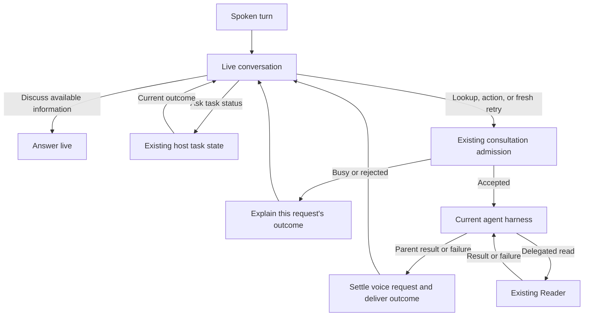

# Voice request recovery on the current harness

Status: Production approved; implementation complete, validation in progress
Issue: [#290](https://github.com/coletaylor788/puddles/issues/290)
Last updated: 2026-10-14

## Human section

### Design

Voice can mistake a status question for new work, reject that extra request
while the original task is running, and describe the rejection as though the
original task failed. After a task finishes or fails, voice must remain able to
send another request in the same conversation.

Repair these shared voice boundaries on the currently deployed harness. Keep
its adapter unchanged. Steering and migration compatibility are deferred.
Reader behavior, fetch limits, and registry storage are outside this proposal.

#### Keep conversation and status separate from new work

Keep reasoning, explanation, brainstorming, and discussion of existing results
in the live model. Preserve [plan 055](055-live-conversation-default.md).
Delegation remains appropriate when the request needs unavailable information,
tools, or actions. Discussion during a lookup does not itself create more work.

Questions such as "Are you actually checking?" and "How's that lookup going?"
need a fresh answer from existing host task state. They must not launch another
harness turn or rely on a guess from conversation history. Repair the current
control classification, including the overly broad treatment of a leading word
such as "also." Preserve cancellation and negation handling.

#### Describe admission accurately

Do not say "I'll check that request" before the request is accepted. Distinguish
accepted work from rejected input and from a request whose delivery is uncertain.
Admission confirms receipt, not tool progress or a successful result. Keep task
identity and state in host-owned context so voice can describe the right request.

If new input is refused while the harness is busy, explain that the additional
request was not accepted and report the original task's actual state. Preserve
the original task, its eventual result, and the live call. Do not describe that
refusal as a failure of all delegation or announce that the additional request
was applied.

#### Handle unsupported steering without breaking the call

Steering remains unavailable in this scope. A request to change active work must
receive a prompt, accurate capability response. Do not retry through the missing
input interface, silently queue the instruction, or cancel and restart the task
to imitate steering. Status and ordinary conversation remain available while
work runs. Preserve the existing explicit cancellation control.

If the active task finishes before a fresh request is admitted, the existing
admission path may accept that request as a new turn. Correlate the outcome to
that input so it is either accepted once or explicitly refused. Do not replay
input whose acceptance is uncertain. This proposal adds no queueing behavior.

#### Deliver the outcome and allow another request

Let the parent agent handle Reader's results and failures normally, including
its own recovery. A reader tool failure does not by itself end a still-running
parent task. Once the parent returns a result or terminal failure, deliver that
outcome to voice and release that attempt's active state. Preserve useful partial
results. A completed or failed attempt must not leave voice permanently busy or
waiting for a child that was never successfully launched.

The live model can then send a fresh contextual request when useful to fulfill
the caller's request, or when the caller says "try again." Include the earlier
outcome and any revised instruction, as another text message would. Give the
new attempt its own request identity. This does not need an extra voice-specific
permission step and does not introduce an automatic repeat-until-success loop.
Existing tool permissions and external-action approvals still apply.

Use the current harness's existing completion and ownership mechanisms. Test
ordinary results, delayed child results, failures, and the next request. Repair
only demonstrated shared voice delivery or cleanup defects. Preserve cancellation,
call ownership, and accepted-work behavior after hangup; do not weaken those
checks to release a reply. Unknown outcomes of accepted external writes must
not be replayed as part of a retry.

Reader limits and persistence failures may still prevent an individual task
from succeeding. Those are separate concerns. This work requires a truthful
outcome and a usable next voice request, not a reader or registry repair.

### Status

**Approval:** Production approved. **Approval reference:** On 2026-10-14 the
requester replied "approved" to the narrowed current-harness proposal. Approval
covers shared voice routing, truthful admission feedback, busy-input recovery,
and fresh requests after terminal outcomes through review, release, and cleanup.
Steering, migration compatibility, harness-specific adapter repairs, reader
changes, registry storage repairs, and new queueing remain excluded.

The inspected call shows an accepted original request followed by rejected
additional input and misleading voice feedback. Installed classifier probes
reproduce missed status questions and an overly broad follow-up marker. The
controller acknowledges before admission and handles unsupported input through
its overlap recovery path. Real-model validation also reproduced a status question
missed after earlier discussion accumulated in the transcript. A narrow status
match preserves that context and keeps mutating-control rules unchanged.
A further live run answered from an earlier progress update without checking the
host. The voice instruction now explicitly requires a new delegation for each
status question. This must pass fresh live validation before release.
Focused tests now prove that failed admission and completion racing extra input
can suppress the original outcome. The shared voice repairs preserve that outcome
and allow a fresh request. Source review is clear; installed and real-model DEV
validation are in progress. No runtime change has reached production.

## Agent section

### State

Implementation follows `safe-feature-development` under the recorded production
approval. The current harness and route remain the acceptance target. Do not wait for or qualify a future harness as part of this work. Keep this existing file path so links and the open proposal remain valid.

Related designs are [voice progress](050-talk-conversation-progress.md) and
[live conversation](055-live-conversation-default.md). Keep private transcripts,
installed paths, and account information in the requesting conversation.

### Scope and acceptance criteria

Repair shared voice classification and admission feedback on the current
harness. Preserve the original task when overlapping input is refused. Prove
that parent completion or failure reaches voice and permits a fresh contextual
request; fix demonstrated shared voice defects that prevent it.

Exclude steering, native interruption integration, migration or cross-runtime
completion adapters, harness-specific repairs, new queueing, reader changes,
fetch-limit changes, and registry storage repairs. Do not change the voice model
or replay uncertain accepted work. The scenario table defines acceptance.

### Architecture and decisions

The installed inspection identifies these source locations:

- `src/talk/agent-run-control-shared.ts`: natural status phrasings miss the
  conservative patterns, while a leading follow-up marker can capture discussion.
  Preserve the distinction between inferred mode and `shouldAutoControl`.
- `extensions/openai/realtime-quicksilver-delegation-controller.ts`: initial
  acknowledgement precedes the runner call. Overlap recovery must identify the
  unaccepted input, preserve the original result, and keep the call usable.
- `src/gateway/talk/client-agent-consult.ts`: retain current request ownership
  and completion claims. Reproduce current-path failures before choosing a
  delivery or cleanup change; do not add a cross-runtime adapter here.
- `src/agents/embedded-agent-runner/runs.ts`: guarded input may return
  `guarded_injection_unsupported`. Treat that as a bounded capability outcome,
  not a reason to change the harness adapter or weaken the guard.
- [Durable yield handoff](../openclaw-setup/patches/sessions-yield-durable-handoff.md):
  preserve publication and retry rules. Exercise a failed handoff as an input to
  voice recovery without changing the storage mechanism.

Keep separate request IDs and correlate admission, terminal outcomes, and voice
feedback. A fresh request after a known terminal failure is a new conversation
turn. It is not retransmission of uncertain input. Keep existing conversation
context and tool authority on that next turn.

The observed reader and registry failures explain task-level failures, but do
not establish the cause of every voice delivery failure. Existing source findings
justify classification and feedback repairs. Current-path fixtures must supply
the evidence for any additional shared lifecycle repair.

### Implementation

1. Add focused current-path regressions for status classification, conversational
   follow-up markers, and acknowledgement after admission.
2. Exercise busy-input refusal through the existing voice controller. Make its
   response name the refused input and preserve the original task and result.
3. Exercise parent success, terminal failure, reader failure, and failed child
   handoff through current voice and text paths. Verify a fresh contextual
   request can reach the harness afterward. Repair only demonstrated shared
   voice delivery or active-state cleanup failures.
4. Validate real voice-model decisions in isolated DEV, including discussion
   while busy, natural status requests, and a fresh attempt after failure.
   Keep harness selection, reader behavior, and existing controls unchanged.

### Validation

| Scenario | Required result |
| --- | --- |
| Begin a lookup, then brainstorm | One accepted lookup; discussion remains live. |
| Ask whether it is running in several natural phrasings | Fresh host status; zero new harness turns. |
| Discuss a returned result, including a leading "also" | Reuse the result; no unnecessary delegation. |
| Admission fails | No claim that checking started. |
| Additional input arrives while busy | Accurate refusal; original task, final result, and call preserved. |
| Request a change to active work | Steering unavailable; no injection retry, silent queue, or automatic restart. |
| Input races original completion | Accepted once as a new turn or explicitly refused; no lost outcome. |
| Parent succeeds or fails, then voice sends another request | Previous attempt settles; new contextual turn reaches the current harness. |
| Reader fails while parent recovers | Parent stays active until its own outcome; no premature voice cleanup. |
| Reader or child handoff fails, then caller says try again | Outcome delivered; fresh request admitted as text would be, with Reader unchanged. |
| Accepted input has an unconfirmed receipt | No automatic replay or false rejection claim. |
| Delayed child result, cancellation, hangup, and reconnect | Existing ownership and cancellation rules retained; no duplicate or stale result. |
| Repeated read limitation | Honest failure; call remains usable without an automatic retry loop. |

Use synthetic content, recording tools, isolated state, and the currently
selected harness. Real voice-model checks must measure delegation decisions,
not merely prompt wording. Keep focused tests, installed DEV evidence, and
physical microphone acceptance distinct. Required unavailable checks fail.

### Rollout and rollback

After implementation approval, follow focused local tests, installed DEV
validation, retained independent review, and the managed cumulative CI, TEST,
and PROD lifecycle on the current harness. Register applicable maintained-patch
regressions in the cumulative manifest. Roll back through the release controller
with matching configuration and state. No production deployment has occurred yet.

### Review log

The retained implementation review identified a completion race: known refusal
after the original task ended still closed the call and suppressed its result.
The correction preserves the result only when input was not admitted and the
call owner remains current. Composed regressions use the voice controller,
Gateway owner, real run registry, and control adapter for both success and failure.
The reviewer cleared the complete source diff after remediation. Stale ownership
and accepted input with an uncertain receipt retain their existing protections.
Live-model validation reproduced a status question prefixed by earlier live
discussion. The correction matches only the two precise status-question forms
at the end of accumulated input. Transcript storage and cancellation/negation
precedence remain unchanged. The added composed regression checks the real
classifier, status callback, original result, and retained context on the next
request. The retained reviewer cleared this correction and the complete current
source diff. A subsequent provider run skipped host control and answered from
earlier progress. The added runtime instruction makes each new status question
require its own fresh host result; retained review and real-model checks cover
that correction. Refreshed live-model evidence, installed DEV, and managed release
gates remain required.

### Checklist

- [x] Inspect the observed call and installed voice-control path.
- [x] Reproduce classifier failures without live inference.
- [x] Restrict the proposal to shared voice fixes on the current harness.
- [x] Approve implementation of the narrowed design.
- [x] Validate classification, accurate feedback, and busy-input recovery in focused tests.
- [x] Prove terminal outcomes allow a fresh contextual voice request in composed tests.
- [ ] Complete DEV, review, cumulative release gates, and physical acceptance.
