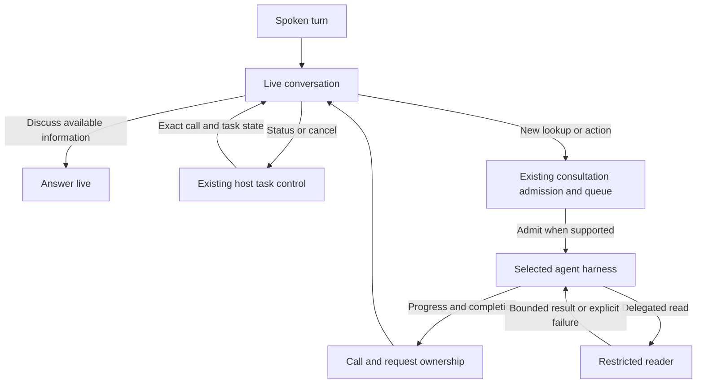

# Voice task control across harnesses

Status: Proposed; runtime compatibility partly validated
Issue: [#290](https://github.com/coletaylor788/puddles/issues/290)
Last updated: 2026-10-14

## Human section

### Design

Changing the agent harness does not repair the voice bridge around it. Voice can
mistake a status question for new work, reject a follow-up while work is active,
and describe that rejection as if the original task failed. A CLI harness also
uses a different run lifecycle from an embedded harness. Voice must retain the
right to deliver its result without depending on an embedded-only registration.

Fix these shared boundaries while qualifying the incoming harness. Do not invest
in the outgoing harness's input adapter.

#### What migration changes

The incoming CLI adapter supports sequential turns in a retained session and
cancellation. The inspected version rejects a concurrent second turn and does
not expose the guarded input interface used by Talk for mid-turn changes.
Session reuse is not the same capability as steering active work.

| Behavior | Effect of changing harness |
| --- | --- |
| Outgoing adapter's missing guarded input and receipt implementation | That implementation leaves the selected route. Do not repair it here. |
| Mid-turn follow-up | Not established by migration. The inspected CLI adapter rejects concurrent turns. |
| Status routed as another task | Unchanged. Classification happens before the harness. |
| Unnecessary delegation of discussion | Unchanged. The live voice model and its instructions remain. |
| Ordinary and delayed result delivery | Must be qualified. Talk currently claims completion through embedded-run registration. |
| Reader fetch truncation | Shared fetch limits remain. Harness-specific output spilling can change. |
| Subagent registry persistence failure | Shared state and handoff code remain. Changing the reasoning harness is not a persistence repair. |

These are source and isolated-adapter findings. They do not establish an
authenticated CLI turn, end-to-end Talk compatibility, or microphone acceptance.
Qualify the exact migration artifact before changing the voice agent's route.

#### Conversation and task control

Keep reasoning, explanation, brainstorming, and discussion of existing results
in the live model. This preserves [plan 055](055-live-conversation-default.md).
Make the boundary explicit with examples of discussion during a pending lookup
and discussion after a result arrives. Test actual model decisions as well as
the composed instructions.

A live status question needs a fresh host answer, not a new reasoning turn or a
guess from conversation history. Repair the existing control classification so
natural questions about whether a lookup was accepted or is still running reach
the status path. Preserve conservative cancellation and negation handling. Do
not treat a conversational word such as "also" as sufficient evidence of new
backend work. Prefer an explicit control intent where the provider supports it;
keep the existing raw-text path for the current native delegation protocol.

Keep current task identity and admission state in host-owned context. Distinguish
waiting to start, accepted/running, waiting for a child, completed, failed,
cancelled, and delivery unconfirmed. A rejection names the rejected follow-up
and preserves the original task's state. A receipt must not claim tool progress.
Do not announce that checking has started before admission succeeds.

#### Work arriving while busy

Read the selected runtime's capabilities before trying to steer it. Unsupported
steering is a normal capability result, not a fatal voice connection error or an
unbounded wait for a registration that the runtime never makes.

Use the existing serial consultation queue for genuinely new work that cannot
be admitted while the current task runs. Bind each pending request to the call,
caller, and request ID. Keep the existing bounded queue limits, reject overflow
explicitly, and never overwrite an earlier pending request silently. Tell the
caller that work is waiting and send it once after the active task finishes.

Queue only input known not to have been accepted by the backend. Accepted input
with an unconfirmed receipt must not be retried. Preserve the first task's final
result and send the follow-up under its own result identity. Ordinary discussion
and status checks never enter this queue.

An instruction to change active work must not be misrepresented as applied when
the harness cannot steer. Report that limitation and allow the existing explicit
cancel operation followed by a revised request, or a clearly acknowledged
follow-up after completion. Do not automatically cancel an accepted external
action to simulate steering. Closing the call drops work not yet admitted;
already accepted work retains the existing detach, completion, and cancellation
rules. No new durable job system or provider-specific broker is proposed.

#### Result ownership across runtimes

Bind voice completion to the existing admitted run and call lifecycle, with an
adapter for each supported backend kind. Retain exact caller, run, lifecycle,
and cancellation checks. A CLI turn must not need a fictitious embedded-run
registration to release a final answer. Readiness, failure, and cancellation
must settle pending control requests even when steering is unavailable.

Reuse the existing reply-operation and requester-final mechanisms. Qualify a
direct result and a result after a reader handoff. Deliver each once, discard
late output after cancellation or replacement, and preserve the established
accepted-work behavior after hangup. Do not weaken the completion claim merely
to make a CLI result appear.

#### Reader access and completion

The native web fetch tool defaults to a 20,000-character cap and clamps larger
requests to its configured maximum. Changing the harness does not change that
cap. A path to a saved result is not usable if the reader cannot read that path.

First qualify the reader through the incoming MCP tool bridge. For the bounded
documentation use case, propose keeping the 20,000-character default and raising
the permitted explicit request maximum to 64,000 characters through the existing
`tools.web.fetch.maxCharsCap` configuration. This is a shared setting: every role
using that fetch configuration can request the larger output. The proposal
includes that scope and potential increase in token use for explicit larger
requests; it does not claim a per-reader override. Verify the full result reaches
the reader, including a fact near the end, without another transport truncation.
This changes the permitted explicit output size, not the default.

Keep the reader's existing tool restrictions. Do not grant general filesystem
or shell access to recover spill files. Requests beyond the qualified limit
must report incomplete coverage and stop repeating an identical fetch. A new
pagination mechanism is outside this proposal unless native configuration and
the incoming bridge fail the bounded use case.

The observed registry write failure has not been reduced to an underlying cause.
Reproduce it in isolated state before selecting a code repair. Preserve the
current durable handoff behavior: a confirmed uncommitted operation may follow
the existing bounded retry rules, while committed or uncertain writes must not
be replayed. Report a failed reader handoff promptly instead of claiming it will
finish soon. Keep recovery evidence intact.

### Status

**Approval:** Proposed. **Approval reference:** On 2026-10-14 the requester asked
to validate what the incoming harness fixes and propose the remaining work,
with no investment in outgoing-harness-specific fixes. This authorizes the
investigation and proposal. It does not approve these new runtime changes.

Installed source inspection and an isolated transport-stub probe establish the
CLI adapter's sequential-turn, reuse, cancellation, stale-owner, and busy-turn
behavior. A pure installed classifier probe reproduces missed status requests
and an overly broad follow-up marker. No live inference, external tool calls,
production session writes, configuration changes, or deployment were performed.
The CLI completion claim mismatch is a source-level integration finding that
requires an end-to-end fixture. The exact incoming artifact, authenticated
voice path, long-document bridge, and persistence root cause remain unqualified.

## Agent section

### State

This is a documentation-only proposal. Follow the short documentation path in
`safe-feature-development`. Runtime implementation and release start only after
approval. Preserve the outgoing adapter unchanged.

Related designs are [the CLI harness migration](claude-code-subscription-harness.md),
[voice progress](050-talk-conversation-progress.md), and
[live conversation](055-live-conversation-default.md). Keep private conversation
records, installed paths, artifact digests, and account information out of public
plans and issues. The requesting conversation holds the operational evidence.

### Scope and acceptance criteria

Qualify the selected CLI harness for initial work, controls, ordinary and delayed
completion. Repair shared voice classification, truthful admission feedback,
bounded pending work, and the demonstrated reader failures. Do not change the
outgoing harness, switch the voice model, add a scheduler, grant general reader
file access, or replay uncertain accepted work. The scenario table below defines
the behavior gate.

### Architecture and decisions

The inspected installed modules identify these upstream source locations:

- `extensions/anthropic/cli.runtime.ts`: `executeClaudeCli` rejects a live
  session with `currentTurn`, retains idle sessions, and exposes lifecycle
  methods rather than `messageInjectionV2`.
- `src/agents/cli-runner/execute.ts`: CLI reply handles attach cancellation;
  they do not register an embedded message-injection handle.
- `src/gateway/talk/client-agent-consult.ts`: steering awaits
  `owner.registered`; `claimAppend` requires a successful embedded completion
  claim. The registration is not a runtime-neutral readiness signal.
- `src/agents/embedded-agent-runner/runs.ts`: the completion claim is promoted
  by embedded registration. Guarded steering requires injection interface V2.
- `extensions/openai/realtime-quicksilver-delegation-controller.ts`: a single
  `pendingDelegation` can be replaced; the runner waits for steering before
  claiming its result; the initial acknowledgement precedes the runner call.
- `src/talk/agent-run-control-shared.ts`: conservative status patterns miss
  natural status formulations, while a leading follow-up marker can capture
  conversation. Retain the distinction between inferred mode and
  `shouldAutoControl`.
- `src/talk/agent-talkback-runtime.ts`: existing bounded serial consultation
  queue, to reuse rather than introduce another worker or scheduler.
- `src/agents/tools/web-fetch.ts`: `resolveFetchMaxCharsCap`, `resolveMaxChars`,
  and saved-output metadata explain the shared long-document limitation.
- [Durable yield handoff](../openclaw-setup/patches/sessions-yield-durable-handoff.md):
  registry publication and known-uncommitted retry boundaries remain in scope.

Recheck these findings against the frozen migration artifact. Source locations
describe the inspected implementation, not a claim that another candidate has
the same limitations. Do not mistake the isolated transport-stub probe for a
test of the authenticated CLI process, native tool restrictions, or full Talk.

### Implementation

1. Freeze the incoming runtime and role routing. Add an end-to-end fixture for
   initial Talk admission, result ownership, status, cancellation, and a child
   result. Repair the shared lifecycle adapter where that fixture fails.
2. Repair control routing and admission messages. Test discussion and status
   while pending and after completion with the real voice model in isolated DEV.
3. Wire the existing consultation queue for known-unaccepted new work; cover
   capability refusal, overflow, ordering, duplicate notices, and call closure.
4. Qualify the bounded long-document request through the incoming reader route.
   Apply the proposed shared fetch limit only within the approved scope; retain
   the default and account for the larger explicit output in the acceptance test.
5. Reproduce the registry error with full cause and commit-outcome evidence.
   Fix the demonstrated failure and add a persistence regression. Do not add
   speculative retries or rebuild the subagent registry.

### Validation

| Scenario | Required result |
| --- | --- |
| Begin a lookup, then brainstorm | One accepted lookup; discussion remains live. |
| Ask whether the lookup is running in several natural phrasings | Host status; zero new harness turns. |
| Discuss a returned result | Reuse it; no new retrieval or task-control operation. |
| Add two independent requests while busy | Both retained in order, or explicit bounded rejection; no silent overwrite. |
| Unsupported steering | Prompt capability response; original task and call remain alive. |
| Accepted input without a receipt | No automatic replay or claim that it was rejected. |
| CLI result with no embedded registration | Correct final delivery, once, with current ownership. |
| Reader yield and delayed completion | Durable parent correlation and one final delivery. |
| Cancellation, hangup, reconnect, and result races | Existing ownership rules preserved; no stale output or execution of unadmitted work. |
| Long synthetic document with the answer past 20,000 characters | Exact tail fact reaches the reader and parent within the qualified limit. |
| Registry failure before and after commit | Explicit failure or safe recovery according to known outcome; no replay of uncertain writes. |

Use synthetic content, recording external tools, isolated state, and the exact
installed CLI/MCP and voice paths. Verify actual runtime selection; a Claude
model name alone does not prove the CLI harness ran. Require real provider
decision checks for conversational delegation. Keep these distinct from the
offline adapter probe and physical microphone acceptance.

### Rollout and rollback

After approval, follow focused local tests, installed DEV validation, retained
independent review, and the managed cumulative CI, TEST, and PROD lifecycle.
Register applicable maintained-patch regressions in the cumulative manifest.
Roll back through the release controller with matching configuration and state.
Do not use this proposal to deploy or exercise live external actions.

### Review log

Independent architecture review found no material actionable findings. It checked
completion ownership, bounded queue reuse, uncertain delivery, the shared fetch
limit, and the distinction between isolated probes and full qualification.
Documentation validation checks relative links, source references, and the
complete proposal directly. No prose assertion tests or unchanged application
release checks are needed.

### Checklist

- [x] Inspect the migration design and installed control, CLI, and fetch code.
- [x] Reproduce classifier and isolated adapter behavior without live inference.
- [x] Separate outgoing-specific work from shared work and unqualified paths.
- [ ] Approve the shared runtime design and explicit fetch-limit change.
- [ ] Validate and repair the exact incoming runtime through the full voice path.
- [ ] Reproduce and repair the registry failure without uncertain-write replay.
- [ ] Complete DEV, review, cumulative release gates, and physical acceptance.
