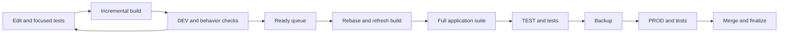

# Application development and tests

Each feature owns its source, prepared OpenClaw checkout, and one reusable build.
The application package builds and tests that output. The independent
[release package](../release/README.md) copies it to environments and handles
queueing, backup, recovery, and cleanup.



## Daily development

Use Node 26.1.0, Corepack 0.36.0, and pnpm 12.4.0. Keep one host package store
and one feature workspace. Install dependencies only when their inputs change.
Use task-owned public/private worktrees and prepared upstream source with the
maintained patches applied. Do not modify a primary checkout.

Run focused package tests while editing. Build the public packages with
`corepack pnpm build`. Build the prepared upstream source incrementally:

```sh
node packages/e2e/bin/build-application.mjs \
  /absolute/feature/openclaw /absolute/feature/application
```

The output must be a sibling of its owned source. The builder uses the upstream
incremental compiler, caches unchanged UI inputs, and materializes a complete
runtime with its dependencies. It refuses another workspace's output. An optional
third argument supplies application plugins as `[{"id":"plugin-id","source":"/absolute/built/plugin"}]`.
Companion builds compose their required plugins and sidecars into the same output.
Environment configuration, credentials, and writable state stay outside it.

Deploy to DEV with the installed controller's `dev CONFIG REQUEST` command.
Shared DEV holds only a short lock for deployment and installed checks. Other
features continue building independently. See [coordination](DEPLOYMENT_COORDINATION.md).

## Full application suite

The release manager runs this against the frozen, already-built feature output:

```sh
OPENCLAW_SRC=/absolute/feature/openclaw \
OPENCLAW_CANDIDATE_DIR=/absolute/feature/application \
  node packages/e2e/bin/openclaw-test-env.mjs ci
```

A companion supplies `E2E_APPLICATION_EXTENSION=/absolute/companion/scripts/application-suite.mjs`.
It declares additional application targets and checks. The runner combines mapped
public/private targets by Vitest project, preserves distinct required modes,
checks collection, and runs each selected target once per project. Independent
projects share four workers by default; explicitly serial tests keep one worker.
Set `E2E_TEST_WORKERS` to change the full-suite worker count. Missing tests
or failed checks fail the suite. It prints durations and does not build, deploy,
archive reports, or run release-tool implementation tests.

Every changed behavior needs a committed regression. Use package tests for local
behavior and `openclaw-patch-suite.json` for upstream patches and cross-component
cases. Update expectations when intended behavior changes. Test functional use,
persistence, restart, and errors. Keep old-data cases only while supported;
remove completed repair fixtures after current state and backup no longer need them.

## Installed tests

TEST runs the real application with separate configuration, state, sessions,
indexes, ports, and processes. External writes and delivery use deny-by-default
recording fixtures. The installed application checks belong to the application,
and are configured as the controller's TEST and PROD commands. Required unavailable
checks fail. PROD checks are bounded, read-only, and never send messages.

This is a trusted host, not a VM or permission sandbox. Share host services and
package caches where useful. Protect production state and foreign processes.

## Adoption

The replacement is being validated and is not yet installed on the Mini.
Existing recovery transactions use [legacy runner commands](LEGACY_README.md),
[legacy coordination](LEGACY_DEPLOYMENT_COORDINATION.md), and
[legacy storage](LEGACY_DEVELOPMENT_STORAGE.md). Do not run both controllers
against the same environments. Complete the Plan 057 adoption checkpoint first.
