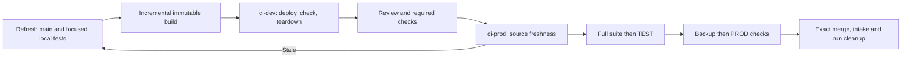

# Application development and tests

Each feature owns its source, prepared OpenClaw checkout, and one reusable build.
The application package builds and tests that output. The independent
[release package](../release/README.md) copies it to environments and handles
queueing, backup, recovery, and cleanup.



Changed candidate source/control inputs repeat build, affected review and DEV.
Workspace finalization is separate and waits for CI references to close.

## Daily development

Use Node 26.1.0, Corepack 0.36.0, and pnpm 12.4.0. Keep one host package store
and one feature workspace. Install dependencies only when their inputs change.
Use task-owned public/private worktrees and prepared upstream source with the
maintained patches applied. Do not modify a primary checkout.

Run focused package tests while editing. Build the public packages with
`corepack pnpm build`. Build the prepared upstream source incrementally:

```sh
node packages/e2e/bin/build-application.mjs \
  /absolute/feature/openclaw /absolute/feature/application
```

The output must be a sibling of its owned source. The builder uses the upstream
incremental compiler, caches unchanged UI inputs, and materializes a complete
runtime with its dependencies. It refuses another workspace's output. An optional
third argument supplies application plugins as `[{"id":"plugin-id","source":"/absolute/built/plugin"}]`.
Companion builds compose their required plugins and sidecars into the same output.
Environment configuration, credentials, and writable state stay outside it.

The low-level builder above is a local engineering tool. For shared deployment,
use the configured installed build entrypoint, then `ci-dev CANDIDATE OWNER`
and, after review/checks, `ci-prod CANDIDATE OWNER`; see [triggered
CI](../release/CI.md). CI holds DEV through deployment, installed checks and
teardown. Other features continue focused testing and building independently.
After dispatch, save its IDs and yield to lifecycle events; inspect the exact
terminal receipt on wake.

DEV and TEST use the same complete output, configuration renderer, service adapter,
and application preparation and acceptance commands. Change bindings for paths,
ports, identities, credential references, and recording endpoints, not application
behavior. Validate the complete rendered configuration and run startup, health,
and the changed feature's installed checks in DEV before joining the queue.
For model behavior, this includes actual provider output; an offline recording
alone does not establish quality. Focused probes help iteration but are not a DEV
deployment. Reconcile DEV experiments with the reviewed base before declaring ready.

## Full application suite

The implementation owner or CI runs this against the frozen, already-built feature output:

```sh
OPENCLAW_SRC=/absolute/feature/openclaw \
OPENCLAW_CANDIDATE_DIR=/absolute/feature/application \
  node packages/e2e/bin/openclaw-test-env.mjs ci
```

The suite requires CPython 3.11 for the packaged native dependencies. Set
`GMAIL_MCP_PYTHON` to the host interpreter; it is used only to create isolated
service environments. Each environment installs the hash-locked test/build tools
in `python-test-tools.lock`, selects its frozen runtime dependencies, and installs
reviewed service source without dependency resolution. Source imports are checked
explicitly before any tests. Gmail and Rocket Money remain separate because their
runtime dependency versions can differ. Chrome, Docker and embedding fixture inputs
remain explicit host prerequisites; the suite does not install those services.

The standalone command owns one deterministic `<artifact>.tests` scratch tree and
bounded SQLite control files under `<artifact>.tests.lock`, all within the feature
workspace. Success, failure and catchable signals join children before removing
scratch, including native transform caches and the combined-project config.
Incremental build/compiler caches stay with the build workspace. After SIGKILL
the next invocation joins the recorded process scope and
reclaims the same tree before restarting. Whole-workspace finalization also owns
these files; a hosted runner owns them through job teardown. Unknown preexisting
scratch is refused. CI adapters can supply `OPENCLAW_APPLICATION_TEST_SCRATCH` only
when their durable operation owns that separate empty directory and cleans it after
child closure, including interrupted-run reconciliation. There is no unmanaged
temporary-directory fallback. The immutable artifact and shared Python environment
are never install destinations.

A companion supplies `E2E_APPLICATION_EXTENSION=/absolute/companion/scripts/application-suite.mjs`.
It declares additional application targets and checks. A companion check may declare
`timeoutMs` from 1 millisecond through six hours when its sequential phases need
a different bound. Omitted values retain the 30-minute default. The runner combines mapped
public/private targets by Vitest project, preserves distinct required modes,
checks collection, and runs each selected target once per project. Independent
projects share four workers by default; explicitly serial tests keep one worker.
Set `E2E_TEST_WORKERS` to change the full-suite worker count. Missing tests
or failed checks fail the suite. It prints durations and does not build, deploy,
archive reports, or run release-tool implementation tests.

Every changed behavior needs a committed regression. Use package tests for local
behavior and `openclaw-patch-suite.json` for upstream patches and cross-component
cases. Update expectations when intended behavior changes. Test functional use,
persistence, restart, and errors. Keep old-data cases only while supported;
remove completed repair fixtures after current state and backup no longer need them.

## Installed tests

DEV and TEST run the real application with separate configuration, state, sessions,
indexes, ports, and processes. External writes and delivery use deny-by-default
recording fixtures. The installed application checks belong to the application,
and are configured as the controller's DEV, TEST and PROD commands. TEST repeats
the shared checks on the frozen candidate with reset state and broader coverage.
It should not introduce a new feature setup or acceptance path. Required unavailable
checks fail. PROD checks are bounded, read-only, and never send messages.

This is a trusted host, not a VM or permission sandbox. Share host services and
package caches where useful. Protect production state and foreign processes.

## Adoption

[Plan 064](../../docs/plans/064-triggered-ci.md) records the completed neutral
dummy, including the repaired target sandbox gate and terminal cleanup. The
cleanup tool is installed and predecessor retirement passed on both hosts. All
four remaining repair checkouts were removed; Fresh target maintenance and final readiness verification passed. Installed CI owns shared DEV and
TEST/backup/PROD/merge. Follow the current [coordination
procedure](DEPLOYMENT_COORDINATION.md#current-process), including reference
checks before workspace finalization. Existing recovery transactions use [legacy
runner commands](LEGACY_README.md), [legacy
coordination](LEGACY_DEPLOYMENT_COORDINATION.md), and [legacy
storage](LEGACY_DEVELOPMENT_STORAGE.md). Do not run both controllers against the
same environments. Recovery cleanup does not reserve the ready queue.